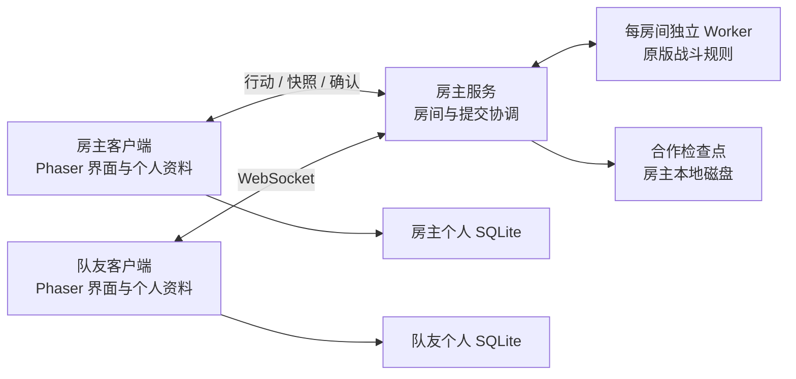

# PokéRogue LAN

基于 PokéRogue 的 Windows 本地游戏与双人局域网合作版本。保留原版单人冒险，在原版战斗规则上加入双人共同推进、各自管理队伍的合作模式。玩家可以自己开房，无需开发者托管的战斗服务器。

> 项目正在开发与测试中。单人和合作主要流程已接通，部分原版机制仍待补齐，尚未完成所有特殊道具、形态、双设备和长局验证。

## 特性

- Windows 桌面程序，图片、音乐与翻译随程序本地加载。
- 原版单人冒险，以及玩家托管的双人合作冒险。
- 局域网发现房主，支持手动填写远程 IP、域名或虚拟局域网地址。
- 原版选队、战斗、捕获、换人、升级学招、进化及战后整备界面。
- 各自保存个人图鉴、成就、统计和存档，房主保存合作冒险。
- 原房间、原席位恢复，以及个人资料导入、导出和数据库备份。

## 与原版的玩法差别

这里的“原版”指本项目采用的 [PokéRogue 历史源码基线](https://github.com/pagefaultgames/pokerogue/tree/ec9365a8bffd8fa0dc050e71ef3eb177e63bc1e9)，不代表与上游最新版本逐项一致。历史基线用于确认规则和内容来源，不是限制精灵种类或世代的玩法规则。

单人模式继续沿用原版玩法；下面的改动主要用于合作模式。

| 内容 | 原版单人 | 本项目双人合作 |
| --- | --- | --- |
| 操作与队伍 | 一名玩家控制自己的队伍 | 每人选择 3 只，各控制自己的精灵；双方通常各上场 1 只，共同双打 |
| 开局预算 | 按原版单人选队约束 | 双方共享 14 点选队预算，分别确认队伍、手动准备后开局 |
| 初始精灵权限 | 使用本人永久图鉴解锁 | 新房可临时共享双方可选图鉴；同一物种跨席互斥，形态与闪光也计为同种 |
| 图鉴所有权 | 捕获、成长等写入本人资料 | 临时共享不解锁永久图鉴；个人成果分别记入本人档案 |
| 回合行动 | 本人提交己方行动 | 两人各交本人行动，房主按同一套原版规则统一结算 |
| 战后整备 | 一人领取奖励与购物 | 每人管理本人队伍、资金和持有物；共享限量奖励与商店库存，双方结束整备后共同推进 |
| 捕获归属 | 捕获精灵归本人 | 精灵归成功捕获者，加入其本局备用选择；永久图鉴成果也归该玩家 |
| 换人与融合 | 在本人队伍内操作 | 只能操作本人队伍；DNA 融合不跨玩家选择精灵 |
| 存档与继续 | 本人保存单人冒险 | 房主保存共同冒险，两人分别保留自己的私有恢复席位 |
| 断线与离开 | 本地继续或退出 | 连接与状态确认影响双方推进；恢复依赖原房主、房间与席位，暂不支持自动房主迁移 |

### 保留的原版规则

合作模式复用原版 Phase、精灵与招式数据、伤害和异常状态计算、随机数、捕获、经验、升级、进化及道具效果。合作层负责分配玩家归属和协调行动，不另写一套简化战斗公式。

攻击通常选择战场位置，换人后由占据该位置的精灵承受；若没有有效目标，则按原规则取消，不额外消费未使用的 PP。捕获绑定具体敌人，目标已离场时取消，不消费未使用的精灵球。

个人队伍全灭时可由队友继续，胜利后按合作恢复流程处理倒下方；双方全灭则冒险失败。有可用替补时需要完成换人才能继续。

### 个人成长与合作成果

单人和合作选择同一个人档案时，共用该档案的永久图鉴。新版新房间支持将遇见、捕获、IV、进化、原成就和券等成果分别写回本人档案，并通过成果回执避免重连后重复发放。旧房间保留原恢复方式，不补发历史成果。

这不是永久精灵实例养成仓库。新冒险继续按原版语义重置本局等级、HP/PP、金钱、持有物和战斗进度；永久保留的是原版收藏与解锁资料。对方临时共享的选队权限不会变成本人的永久收藏。

### 已接入内容与限制

主要合作链路包含战斗、捕获、备用队伍、换人、经验、学招、进化、战后奖励和共享商店。常规道具、回忆蘑菇、Mega、极巨化、太晶化及本人队伍内 DNA 融合已接入。本人形态道具可在整备“查看本人队伍”或战斗“宝可梦”菜单中开启/关闭，由房主保存并同步；战斗中切换不耗回合，但双方须重新选择尚未执行的行动。特殊条件继续使用原版规则，不表示全部形态均已逐项验证。

DNA 融合沿用原版先选主体、再选第二只的流程；第二只离队，原持有物转移及学招流程继续生效，解除融合不会返还第二只。未接入机制的道具从新抽取奖励中排除；旧存档已有未支持奖励不会被静默替换。

大厅“个人资料 → 蛋扭蛋机”可沿原版三种机器消费蛋券，支持单抽和批量抽取。扣券、产蛋和统计先一起保存，再播放原版动画；单人和联机共用本人库存。

新版新建联机房间会推进开局带入的蛋。进度满后等待本局通关或双方全灭，回大厅沿原版动画孵化；断线、暂停和临时返回不触发。带入联机的蛋在本局结束前被保留，不能切换单人消耗同一批蛋。中断动画后可继续展示固定结果，不重复发放图鉴、IV、蛋招或统计。旧房间沿旧策略，不补发历史蛋进度。

尚未完成的主要范围：

- 更多特殊道具、道具转移及剩余特殊形态的逐项验证（剩余原版道具按当前安排暂缓）。
- 地图道具手动选路；当前经典路线按原规则和种子自动推进。
- Android、自动房主迁移与队友鼠标提示。

## 开始游戏

### Windows 桌面版

运行完整发行目录中的 `PokeRogue-LAN.exe`。必须保留整个文件夹，不能只复制 EXE；玩家无需安装 Node.js，也无需打开外部浏览器。

源码仓库不包含构建产物。若没有现成发行包，请按下方源码构建步骤生成：

```text
build/desktop/release/PokeRogue-LAN-win32-x64/PokeRogue-LAN.exe
```

先在大厅创建或选择个人档案，再进入单人或合作模式。个人收藏与单人存档可以从大厅查看和管理。

### 两人合作

1. 双方使用相同版本。房主进入“联机冒险 → 局域网联机”，点击“启动本机房主”，然后创建房间。
2. 队友从局域网搜索结果选择房主，输入六位房间码加入。搜索不到时使用手动连接，填写房主地址。
3. 双方分别选队，点击“完成选队”。确认两排队伍后，各自点击“提交准备”，等待双方同步后开始。
4. 战斗中各自控制自己的精灵；战后分别完成整备，共同进入下一场。
5. 继续已有合作冒险时，先启动原房主，再从“恢复已有联机”使用原席位进入。

桌面版通过 UDP 广播发现同一局域网的房主。访客 Wi-Fi、AP 隔离、不同子网或不转发广播的虚拟网络可能无法自动发现；浏览器端也需要手动连接。

### 远程联机与端口

| 端口 | 用途 |
| --- | --- |
| TCP 18734 | 本机游戏资源，仅监听 `127.0.0.1` |
| TCP 18735 | 默认合作房主服务，可在界面选择端口 |
| UDP 18736 | 局域网发现 |

异地玩家选择“远程联机”，填写房主 IP、域名、`域名:端口` 或完整 HTTP/HTTPS 地址。使用端口映射时填写映射后的游戏地址；使用虚拟局域网时填写房主虚拟网卡 IP。

游戏不提供穿透、中继或隧道配置。六位房间码只标识所连接房主上的房间，不能代替网络地址；n2n 协调服务器地址也不是游戏房主地址。普通 HTTP/WS 不加密通信，远程连接优先使用可信虚拟局域网或正确配置的 HTTPS/WSS 入口。

## 存档与备份

Windows 数据目录为 `%APPDATA%/PokeRogue-LAN`，可从程序菜单打开。更新程序时退出旧程序并替换发行文件夹，保留数据目录。

| 路径 | 保存内容 |
| --- | --- |
| `storage/personal.sqlite` | 本人档案、单人进度、偏好、私有席位和待发行动 |
| `storage/backups/` | 菜单生成的个人数据库备份 |
| `hosts/formal-rooms/` | 房主身份、合作房间和可靠检查点 |

个人数据库与房主房间不能互相替代。个人数据库使用程序菜单备份；复制完整房主目录或数据目录前先退出游戏。运行中不要只复制 SQLite 主文件而遗漏 WAL。备份包含私有恢复凭据，不要当邀请码分享。

桌面版可确认迁移旧桌面资料，并保留原库。外部浏览器资料需先在原浏览器导出个人档案，再从桌面大厅导入；不同浏览器和访问来源的资料彼此隔离。恢复合作冒险需要原房主数据及本人席位，不要向队友复制自己的恢复凭据。

## 架构

### 相比原版发生了什么变化

原版主要由浏览器中的 Phaser 场景运行单人规则并保存资料。本项目保留这条单人链路，为合作增加玩家托管房主、每房间独立的规则 Worker，以及客户端的投影与展示层；桌面端再通过 Electron 接入本地资源和 SQLite。



浏览器客户端使用 IndexedDB/localStorage，桌面客户端使用自己的 SQLite。图中的两份个人资料分别属于两名玩家，不由房主合并保存。

| 层次 | 职责 |
| --- | --- |
| Phaser 界面 | 大厅、原版单人、合作选队与战斗展示；提交玩家意图，播放结果 |
| 房主服务 | 身份、房间、串行处理行动、去重回执、双方状态确认与恢复 |
| 原规则 Worker | 每房间独立运行原版规则，生成检查点、各席位投影与展示事件 |
| 个人资料层 | 图鉴、成就、单人存档与合作永久成果；保持玩家归属和版本校验 |
| Electron 主进程 | 本地资源、受限 IPC、SQLite、房主启停与局域网发现 |

### 行动、同步与保存

合作是房主权威结算：两名客户端发送行动，由房主的原规则 Worker 计算共同结果，再向双方发送各自可见的快照和展示事件。客户端不各自运行一整套权威战斗规则，也不依赖逐帧画面同步来决定伤害或随机结果。

房间按顺序处理提交，使用决策版本、行动编号和回执识别过期或重复操作。候选结果先可靠保存，再发布快照和回执；客户端应用状态、计算摘要并确认后继续。动画进度不会改写权威结果，断线或状态不一致需要恢复同步。

共同冒险和个人永久成果分别保存：房主保留合作检查点，本人资料以事务写入成果与回执，再向房主确认。退出和切换场景需要经过保存检查，未确认保存时保留当前界面，避免把“退出成功”误当作“已安全存档”。

### 桌面与网络边界

Electron 渲染器不直接拥有 Node.js 或任意文件系统权限，通过受限预加载接口访问资料；主进程核对窗口、主 frame 与来源。本机资源监听器和可供队友连接的房主监听器分开，房间服务不提供个人数据目录下载。

图片、音频和翻译本地加载。合作房主由玩家主动运行，没有开发者中央战斗服务器，也没有自动房主迁移。

## 从源码运行

需要 **Node.js 24 或更高版本**及 npm。推荐使用与 CI 一致的 Node.js 24。

```powershell
git clone https://github.com/northstreet01/pokerogue-lan.git
cd pokerogue-lan
npm ci --ignore-scripts
```

### 浏览器开发

```powershell
npm run start
```

默认地址为 `http://localhost:8020/`，监听本机。该入口用于前端开发；正式浏览器合作入口需要构建 Worker 和前端，并启动本地服务：

```powershell
npm run build:coop-runtime
npm run build
npm run start:local
```

需要对局域网开放浏览器服务时使用 `npm run start:local -- --host`。不要只上传静态 `dist` 代替合作房主服务。Vite 开发服务与独立服务择一运行，避免端口冲突。

### 构建 Windows 桌面版

```powershell
node node_modules/electron/install.js
npm run review:code
npm run typecheck
npm run build:desktop
npm run package:desktop
```

固定输出目录为 `build/desktop`。开发运行使用 `npm run start:desktop`；发行运行使用 `release` 子目录中的 EXE。构建或替换发行包前先退出正在使用的程序。

## 开发与贡献

```powershell
npm run review:code
npm run typecheck
npm test
npm run test:desktop
```

其他测试入口包括 `test:local-save`、`test:localization`、`test:coop` 和 `test:battle-core`，按修改范围选择。涉及规则时核对原版行为，涉及存储时检查失败保存、重复提交和恢复边界。结构检查、自动测试与构建不能替代真实双设备、声音和长局手测。

联机和规则测试会重建共用的测试 Worker，因此按文件串行执行；请勿在同一工作目录同时启动这两套测试。CI 在测试前先构建 Worker，干净检出无需预先保留 `build/` 目录。基础检查、规则回归和四个联机文件分片在独立运行器并行执行，保留全部测试和汇总 `verify` 检查；每个分片内部仍串行，避免共用 Worker 互相覆盖。所有PR及main推送自动检查，其他分支可手动触发，避免同一PR提交被push和PR事件重复运行。失败时查看对应分片的具体断言，推送成功不代表 CI 已通过。

提交 Issue 时附上版本、复现步骤和脱敏后的错误信息。不要附带真实存档、数据库、恢复凭据或私人诊断目录；漏洞请按 [安全说明](SECURITY.md) 私下报告。依赖与安全扫描通过 GitHub Actions 和 Dependabot 持续维护。

## 许可证与致谢

源码遵循 [GNU AGPL-3.0](LICENSE)，基于 [pagefaultgames/pokerogue](https://github.com/pagefaultgames/pokerogue)。Pokémon 及相关素材的权利归各自权利人所有，本项目与其无隶属关系。

部分目录译文参考 PokeAPI，来源与逐项摘要保留在 [翻译来源清单](locales/catalog-sources.json)，许可随 [PokeAPI 许可文件](public/licenses/pokeapi.txt) 分发。感谢上游开发者、素材作者和翻译贡献者；原素材署名保留如下。


# Credits
> If this project contains assets you have produced and you do not see your name here, **please** reach out.

### BGM
  - Pokémon Mystery Dungeon: Explorers of Sky
    - Arata Iiyoshi
    - Hideki Sakamoto
    - Keisuke Ito
    - Ken-ichi Saito
    - Yoshihiro Maeda
  - Pokémon Black/White
    - Go Ichinose
    - Hitomi Sato
    - Shota Kageyama
  - Pokémon Mystery Dungeon: Rescue Team DX
    - Keisuke Ito
    - Arata Iiyoshi
    - Atsuhiro Ishizuna
  - Pokémon Black/White 2

### Sound Effects
  - Pokémon Emerald
  - Pokémon Black/White

### Backgrounds
  - Squip (Paid Commissions)
  - Contributions by Someonealive-QN

### Game Logo
  - Gonstar (Paid Commission)

### Trainer Sprites
  - GAMEFREAK (Pokémon Black/White 2, Pokémon Diamond/Pearl)
  - kyledove
  - Brumirage
  - pkmn_realidea (Paid Commissions)

### Trainer Portraits
  - pkmn_realidea (Paid Commissions)

### Pokemon Sprites
  - GAMEFREAK (Pokémon Black/White 2)
  - Smogon Sprite Project (Various Artists)
  - Skyflyer
  - Nolo33
  - Ebaru
  - EricLostie
  - KingOfThe-X-Roads
  - kiriaura
  - Caruban
  - Sopita_Yorita
  - Azrita
  - AshnixsLaw
  - Hellfire0raptor
  - RetroNC
  - Franark122k
  - OldSoulja
  - PKMarioG
  - ItsYugen
  - lucasomi
  - Pkm Sinfonia
  - Poki Papillon
  - Fleimer_
  - bizcoeindoloro
  - mangalos810
  - Involuntary-Twitch

### Move Animations
  - Pokémon Reborn
