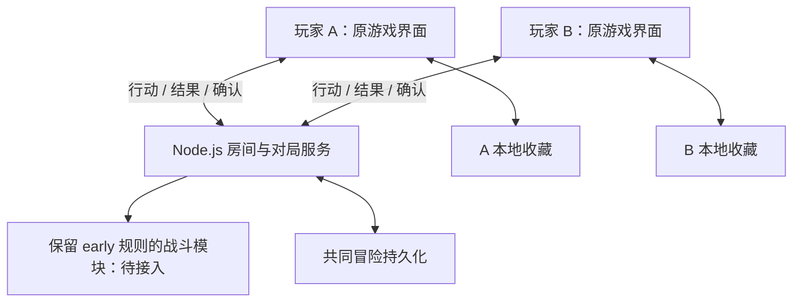

# PokéRogue Early 合作项目规格与进度

更新日期：2026-10-16。本文依据用户已确认要求和本地代码现状编写。

本文区分“目标需求”“当前实现”和“验收证据”。代码存在不代表正式游戏已经接入，实验测试通过不代表原版玩法兼容。后续文档与本文冲突时，以用户最新要求为准，并同步修正文档。

开发入口：[联机架构与接口](docs/coop-architecture-2026-10-13.md) · [分模块计划与进度](docs/coop-development-plan.md) · [新窗口交接](docs/DEVELOPMENT-HANDOFF.md)。M1 契约与 M2 安全停点状态层已验收，见 [M1 记录](docs/coop-contract-m1-2026-10-13.md)和 [M2 记录](docs/m2-checkpoints-2026-10-14.md)；完整权威原运行器仍待 M3。

## 1. 项目目标与开发边界

在选定的 early 原游戏基础上，保留单人玩法、原游戏画面、图鉴收藏与扭蛋系统，增加可以通过局域网或服务器进行的双人合作。每位玩家独立经营自己的队伍和资源，两人共同战斗并推进冒险。

| 项目 | 基线 |
|---|---|
| 工作目录 | `E:\pokeregue\pokerogue-early` |
| 项目仓库 | https://github.com/northstreet01/pokerogue-early |
| 原版来源 | `pagefaultgames/pokerogue` |
| 固定历史提交 | `ec9365a8bffd8fa0dc050e71ef3eb177e63bc1e9`，记录版本 1.0.0 |
| 基础提交 | `2499edd7`：early 离线基础及设计记录；后续审查提交以 Git 历史为准 |
| 原有新版目录 | `E:\pokeregue\pokerogue`，保留其代码和未上传内容 |

玩法兼容验收中的“原版”指上述固定 early 版本。语言切换等扩展功能则按用户最新要求，优先从上游已有实现移植并适配，不要求扩展也停留在 early 的实现方式。基线身份记录于 `BASELINE.json`；独立仓库不包含该上游提交对象，后续历史差分应使用匹配的原始源码或上游检出核对。

**必须遵守的边界：**

- 保留 early 已有的精灵、招式、成长、图鉴及战斗规则；仅调整用户明确确认的合作差异。
- 用户再次明确：不因版本限制精灵种类、世代或数量。固定历史提交是代码来源和规则对照基线，不是精灵范围上限；未接入内容须记录为开发缺口，不能转成产品限制。
- 不以“减轻实现难度”为理由自行裁剪已有内容或另写简化规则来替代原游戏。
- 暂不追赶上游后来新增的复杂机制；这不等于授权删除 early 已有机制。
- 不改变图鉴数据语义，不新增永久精灵等级或永久个体仓库。
- 未接入原游戏的独立验证页，不得作为合作游戏已完成的交付。
- 不迁移、清空或覆盖个人存档来掩盖兼容问题；修复必须保留原数据。
- 语言切换等扩展功能优先复用原版实现、资源和数据约定，仅为 early 的接口、离线环境和画面作必要适配；不另造替代系统，不重写 early 独有文案。移植时记录来源、差异和验证范围，不借移植改动玩法或图鉴语义。
- 游戏未保存语言偏好时默认简体中文；保留已选择的语言，提供简体中文/英文切换。对应不上原规则的说明保留旧文案，不直接套用现代机制的翻译。

## 2. 已确认的玩法需求

| 编号 | 要求 |
|---|---|
| PLAY-01 | 支持创建房间、通过房间码加入，固定两名玩家。 |
| PLAY-02 | 每人从自己的收藏选择 3 只精灵，各上场 1 只，共同参与双打；后备队伍互相独立。 |
| PLAY-03 | 各自持有金钱、精灵球、道具，各自选择奖励和购买；一人的消费不扣另一人的资源。 |
| PLAY-04 | 共同推进战斗与冒险波次；战后双方完成整备并准备后才继续。 |
| PLAY-05 | 捕获在战斗中进行，成功后敌人离场，归捕获者所有，不向另一人增加捕获解锁。遇见记录仍按实际遭遇处理。 |
| PLAY-06 | 捕获个体进入捕获者的本局备用列表，战后可替换个人队伍。永久侧按原版更新收藏，本局备用列表随新冒险重置。 |
| PLAY-07 | 一人全部倒下时，存活玩家继续。过关后给倒下玩家恢复机会；已批准方案为第一只精灵恢复一半 HP。双方全灭则失败。适配测试链路已在原 BattleEnd 完成后复用原 REVIVE 50% 效果恢复个人第一位，不消耗物品；敌我同回合全灭的最终顺序仍见第 8 节。 |
| PLAY-08 | 倒地后的强制替补在回合结束时处理，不由客户端自行插入行动。 |
| PLAY-09 | 普通攻击绑定目标位置。轮到行动时位置已空，则本回合行动失败，不自动改打其他目标，不扣尚未使用的 PP；若换人后新精灵占据同一位置，则攻击新精灵。 |
| PLAY-10 | 捕获绑定敌方具体实例。若目标已离场，后续捕获取消，不消耗尚未使用的球。 |
| PLAY-11 | 新冒险按 early 原版初始化等级等状态；Lv.5 是开局等级，不是永久收藏等级。实验页的 1000 金钱、5 球、2 伤药等数值不据此成为正式需求，须与原版核对。 |
| PLAY-12 | 保留单人游玩与本地存档能力。单人与合作最终复用经原版兼容验收的规则，不能让实验引擎直接替换单人。 |
| PLAY-13 | 经验按合并双方实际参战成员计算一次，再发给各自符合原版条件的个人队员；保留原版经验公式和各自道具效果，不给双方各复制一份完整经验。用户于 2026-10-15 确认；适配测试链路已接原经验、LevelUp／学招／进化，完整胜利仍待接。 |
| PLAY-14 | 每次共同过关，双方各自的蛋都推进 1 波，孵化结果归蛋的原持有人；不因个人在战斗结束时全队倒下而排除。用户于 2026-10-15 确认；适配测试链路已执行原 EggLapse 和原生成规则并保存个人结果停点；完整孵化／永久事务仍待接。 |
| PLAY-15 | 合作始终双打；合作奖励池排除 LURE／SUPER_LURE／MAX_LURE 三种提高双打遭遇率的诱饵，单人奖励保持原规则。用户于 2026-10-15 明确要求；适配测试已在原阈值构建前排除并验证原下标／单人默认池。 |

合作导致原版无法直接适用的规则应单独列出差异与验收案例；未明确的差异不得用实验页的实现默认定案。

## 3. 原版图鉴与存档模型

### 3.1 永久收藏

`src/system/game-data.ts` 中的 `DexData` 按物种 ID 保存 `DexEntry`，是累计解锁记录，不是逐只精灵的永久仓库。

| 字段 | 含义 |
|---|---|
| `seenAttr` / `caughtAttr` | 见过/捕获过的属性位集合，包括普通/闪光、性别、特性槽与形态 |
| `natureAttr` | 解锁性格的位集合 |
| `seenCount` / `caughtCount` / `hatchedCount` | 遇见、捕获、孵化次数 |
| `ivs` | 六项分别记录累计最高个体值 |

系统存档还包括训练家身份、`starterMoveData`、`starterEggMoveData`、统计、解锁和成就、扭蛋券及未孵化蛋。它们继续遵守原版持久化语义。

捕获/孵化通过 `setPokemonCaught`、`setPokemonSpeciesCaught` 更新图鉴；个体值由 `updateSpeciesDexIvs` 更新。原版会向进化前物种递归更新相关捕获解锁和 IV。初始精灵选择界面使用这些数据决定可选物种、形态、性格、特性等。合作适配不能漏掉这些联动。

### 3.2 本次冒险

等级、当前 HP/PP、状态、队伍、金钱、背包、战场和波次属于冒险数据；合作新增的个人本局备用列表也属于这一层。继续同一冒险应恢复它们，开始新冒险则重新初始化。

### 3.3 保存职责

- 浏览器 IndexedDB `pokerogue-early-local`：个人系统收藏、单人槽位，以及合作授予去重记录和席位恢复凭据。当前实验收藏另存为 `coop-experiment-data`，账本另存为 `coop-experiment-grants`；实验结果不回写正式 `data`。设置和教程目前仍使用 localStorage。
- 服务器：共同对局状态、随机流、双方本局资源、待提交行动、回执、授予记录与检查点。
- 浏览器存档按访问来源隔离，`localhost`、IP 地址和域名对应不同存储；切换地址通过备份迁移，不能声称数据自动互通。
- 收藏结果及其去重记录必须同一事务落盘，成功后才确认，防止重连重复计数。
- 本地存档失败要显示错误并暂停相关推进，不以新空档覆盖旧档。
- 全量浏览器备份和服务器房间备份职责不同，不能互相替代。备份中的私有席位凭据不得公开。

## 4. 联机架构要求

采用 Node.js 独立服务与 WebSocket。参考 Stronghold-Protocol 的服务、房间和重连分层方向，不移植其战斗规则。本项目固定采用服务器权威结算。

这是两客户端连接同一权威服务器的 C/S 架构，不是浏览器直接 P2P。局域网可以由一位玩家的电脑运行服务器，但其浏览器没有额外裁决权。先预留并实现正式联机接口，提前接两端测试，不等单端引擎全部完成才接网络。

上图是目标结构。目前 A/B 为独立验证页，E 为有限实验引擎，不能与目标实现混同。

### 4.1 房间与部署

- 创建者是普通玩家席位，不因创建房间获得客户端战斗裁决权。
- 房间码在同一服务器内有效；另一台设备必须访问该服务器地址。
- 局域网由一台电脑运行 Node 服务；远程部署时双方访问同一远程服务。两者使用相同协议。
- 原席位用私有凭据恢复，不允许仅凭公开房间码接管已开始的玩家席位。
- 暂无跨服务器大厅、自动网络穿透、账户或竞技防作弊系统；不作为当前已完成能力。

### 4.2 防止不同步的必要约束

1. 服务器独自决定联机随机数、行动顺序、伤害、捕获、胜负和进度。客户端提交意图并展示结果。
2. 输入必须与当前对局、决策、状态版本和玩家所有权对应；使用唯一指令编号去重。
3. 房间状态修改串行执行，网络包抵达先后不得代替战斗速度与优先级规则。
4. 收齐本次决策需要的行动才结算；全灭玩家可无需提交战斗行动，但仍接收状态。
5. 结果和去重回执成功持久化后才广播；保存失败不发布未提交状态。
6. 两端应用完整状态、完成必要本地收藏写入并确认后，才开放下一次决策。
7. 确认必须对应当前版本；迟到的旧确认不能确认新状态，也不应误报为当前不同步。
8. 断线、当前状态校验失败或本地保存失败时阻止推进，不自动代选或跳过回合。
9. 动画完成时间与播放速度不能决定战斗结果；禁止靠动画回调自行推进权威战斗。
10. 协议、规则及内容版本不兼容时拒绝开局/恢复，保留存档并说明原因。

正式游戏接入后，校验要覆盖实际应用的战斗模型，不能只对收到的 JSON 校验就宣称画面与游戏状态已同步。双方结果一致也不代表规则正确，仍须与 early 原版进行差分验证。

### 4.3 标准流程

打开原游戏 → 选择单人或合作 → 创建/加入房间 → 各自选择 3 只 → 初始状态校验 → 各自选择行动 → 服务器统一结算 → 双方应用并确认 → 后续回合或战后整备 → 各自奖励/购物/换队 → 双方准备 → 下一战。

战后允许保存并暂停；恢复须双方回到原席位并校验。临时断线也暂停，恢复后继续同一待决策状态，不能重复消耗物品或重复发放收藏。

### 4.4 接口与检查点开发约束

- 先完成正式消息版本、运行时校验和适配接口：行动、回执、快照、实际模型确认、授予确认、状态请求、席位恢复；契约详见架构文档第 3 节。它们不等于当前实验协议已经具备的能力。
- 输入绑定对局、决策、预期版本与唯一动作 ID；身份来自连接。连接代次隔离旧连接晚到确认，版本拒绝不能清空旧存档。
- 完整检查点覆盖精灵与效果、个人本局资源、所有随机流、决策上下文、已收输入、去重回执及待授予。恢复不得直接给只读属性赋值或重复执行效果。
- 在安全决策边界保存，包含学习招式、进化等原版交互的适配清单；动画与函数 Phase 不能直接序列化。接受单方输入也先落盘，服务器重启后重新建立双端确认。
- 每个状态切片同时做单端原规则差分和双端实际模型恢复测试；共享与个人视图分别校验，语言/动画/在线/ACK 等显示或协调数据不进入共享战斗摘要。

### 4.5 复用优先与后续开发约束

用户于 2026-10-14 明确要求：后续开发必须考虑复用原项目和此前联机项目，减少重复实现、节省工期。M3–M8 是尚需接入和验收的工作包，不是六套从零开发的系统。优先顺序为：当前 early 已有实现 → 固定 early 原版逻辑/界面 → 此前项目可迁移的联机实现与测试 → 必要的新适配代码。

来源范围：本仓库为 `E:\pokeregue\pokerogue-early`；此前项目为 `E:\pokeregue\pokerogue`，只读参考，禁止修改、重置、清理或覆盖。移植结果必须落在 early 仓库，不建立对另一目录的运行时依赖。本清单基于 2026-10-14 源码和此前项目 `docs/coop-server.md` 的只读核对；候选项不等于已移植或已验收。

| 对应模块 | 优先复用的来源与文件 | 可复用部分 | 必要适配与验收边界 |
|---|---|---|---|
| M3 原运行器 | early：`src/phases.ts` 的 MovePhase/MoveEffectPhase、`src/field/pokemon.ts`、`src/data/move.ts`、`src/data/ability.ts`、`src/modifier/` | 原伤害、命中、PP、状态、特性、AI、捕获、成长、进化和道具规则；已有 `src/battle-core/` 提取函数继续复用 | 提取或调用原逻辑，分离场景/动画依赖、绑定房间 RNG 和安全停点；不得另写简化公式取代原机制 |
| M3/M7 状态与协调 | early：`src/original-phase-checkpoints.ts`、`src/battle-core/`、`server/formal-coop-service.mjs`、`src/battle-core/coop-client.mjs` | M1/M2 协议、检查点、队列、所有权、输入去重、先落盘后发布、实际模型确认及恢复基础 | 接原运行器和正式客户端；不再新建一套房间/快照/ACK 系统，不用实验引擎回落 |
| M4 房间大厅 | 此前项目：`server/lobby.html`、`server/lobby.js`、`server/lobby.mjs`、`server/lobby-page.mjs` | 昵称、建房/加入、邀请码/邀请链接、准备状态、进入游戏交接的界面和交互 | 改接 early 正式协议和原席位恢复凭据；旧 Host/Client 权限、一次性 ticket、房间码格式不能直接当成当前契约 |
| M4 选队与行动 UI | early：`src/ui/starter-select-ui-handler.ts`、`command-ui-handler.ts`、`fight-ui-handler.ts`、`target-select-ui-handler.ts`、`party-ui-handler.ts`；此前项目：`src/lan/send-action-phase.ts`、`remote-collect-phase.ts` 及对应 UI handler | 原选队/出招/目标/替补界面；旧联机行动采集、请求配对及显式绑定 CommandPhase 的经验和代码片段 | UI 提交意图，由服务器校验/推进；按 early 接口、席位和稳定 Pokemon ID 适配，保留单人路径 |
| M4 展示事件 | 此前项目：`src/lan/turn-event.ts`、`turn-event-logger.ts`、`replay-phase.ts`、`remote-switch-summon-phase.ts` | 招式、伤害、回复、状态、倒下、换人和提示事件的采集/播放组织；先展示中途事件再弹替补选择的时序经验 | 转为消费服务器已提交的事件，适配 early 动画接口；回放不得再次结算、扣 PP/物品、授予收藏或推进权威回合；未知事件不得静默跳过 |
| M5 整备 | early：`src/phases.ts` 的 SelectModifierPhase、`src/ui/modifier-select-ui-handler.ts`、`party-ui-handler.ts`、`src/modifier/`、`src/battle-core/safe-decisions.mjs` | 原奖励、商店、道具、队伍界面和规则；M2 已有各席选择/重抽/子决策/准备状态及地图协商 | 接各自个人资源与决策，双方准备后继续；旧项目由 Host 替 Client 选择奖励的流程不符合批准玩法，不能直接移植 |
| M6 收藏与局外 | early：`src/system/game-data.ts`、`pokemon-data.ts`、`egg-data.ts`、`voucher.ts`、`local-save-store.ts` 及原孵蛋/扭蛋 UI | 原捕获/图鉴/IV/进化链/蛋/券语义，本地事务、备份与存档保护 | 增加合作归属与持久化授予去重；不重做收藏系统、不引入永久实例仓库，不把实验收藏写回正式图鉴 |
| M7/M8 测试与部署 | early：现有 `tests/battle-core*.test.mjs`、`tests/coop*.test.mjs`、`tests/local-save.test.mjs`；此前项目：`server/coop-server.test.mjs`、`coop-phases.test.mjs`、`lobby.test.mjs`、`server/index.mjs` | 已有双客户端 WS、房间隔离、旧 ACK、跨波次、替补请求、大厅交接案例，以及同域 HTTP/WS 部署经验 | 优先扩展现有测试入口，移植故障场景并改接当前契约；原项目的协议/隔离测试不能当完整 Phaser 对战或真实双机验收 |

不得整套照搬此前项目的 `CoopManager`、Host/Client Phase 分叉和轻量终态快照。此前项目由 Host 浏览器结算，当前要求服务器权威；旧摘要未覆盖完整 Arena、后备、RNG 和待续 Phase，断线续局也未完成。这些是需要替换的架构边界，不是否定其中的大厅、展示和测试代码。新版 `globalScene`/PhaseManager、模块别名及数据字段须按 early 实际接口适配；不为迁移顺便改动原规则或缩减精灵范围。

每个后续开发切片必须执行并记录：

1. 开始实现前先检索本清单的已有文件/测试，说明本切片复用哪些函数、界面、资源或测试案例；不能直接以“新建实现”为默认起点。
2. 能直接调用则直接调用；需要迁移时保留已有逻辑，只新增必要的边界适配。不复用的候选须记录具体原因，如权威模型、接口、版本数据或验证缺口，不能仅以“旧代码”排除。
3. 移植记录包含来源路径、可核实的提交/版本或未提交状态、实际迁移部分、必要差异和验证结果。不得覆盖此前项目未上传工作，不把旧文档的完成标记当作当前证据。
4. 复用规则仍须与固定 early 原版差分；复用联机/UI 仍须验证当前协议、所有权、恢复和单人兼容。节省重复开发，不省略必要验证。
5. 更新模块计划与交接文档中的“已复用/待适配/未复用及原因”；不重复实现已验收的 M1/M2 基础，不在未核对兼容性前承诺复用比例或工期。

## 5. 当前进度快照

2026-10-16 最新提交核对：累计普通下一战、战前个人换人、遭遇／战斗道具、v6/v7 投影修复和原偷取／持有种子复活切片，已汇总为 `a14337a9` 并推送 origin/main（`3ce98d72` → `a14337a9`），推送后只读实时远端同一提交。汇总包含 52 个代码、测试及文档文件；完整串行回归 **698/698**、类型检查、生产构建及空白检查通过。提交范围未发现存档／房间／依赖／构建产物／临时输出，指定凭据模式未命中；仅限本次范围和模式，不作全历史或绝对隐私保证。M3 仍部分完成，正式 WS 默认 ADAPTER_UNAVAILABLE。下一批原敌方概率复活增益及 revived／maxRevived 限次、原场景 RNG 与 Faint／Heal 队列和失败恢复，再扩展防偷特性及其余树果。以下未提交状态、数量和旧下一步均为当时历史；本次交接文档另行提交，最终 HEAD 以实际 Git 为准。

2026-10-16 最新转移／复活批：普通组合测试链已复用原 Mini Black Hole／Grip Claw 偷取、原 tryTransfer／add／remove／update，以及双方与敌方持有复活种子的 Faint／Heal。真实致死后先扣种子并保存待回血队列，再执行原回血至后续真实输入；恢复不重复扣种子或回复。转移保留原概率／抽取／堆叠及类型共享；跨玩家直接转移拒绝。只给原转移最终 Promise 加已有观察器，并修复共享任务先失败时过早解绑个人场景的问题。新增 51 项（33 单端、18 WS）定向、类型检查和生产构建通过。本批完整串行回归 **698/698** 通过（约 931 秒）。[来源、差异与缺口](docs/transfer-revive-m3-2026-10-16.md)。开工保留 44 个未提交文件，main／HEAD／实时 origin/main 仍 `3ce98d72`，本批未提交／未推送。M3 部分完成，生产 WS 默认 ADAPTER_UNAVAILABLE；下一批原敌方概率复活增益及限次，再扩展防偷特性和其余树果。不改 PLAY-13／14／15、未确认券／同时全倒下顺序、v6/v7、RNG 及 M6 边界。以下是前序证据。

2026-10-16 前序投影修复／补验批：已复现前序战斗道具 WS 的 v6 上下文误走 v7 蛋投影错误，修复既有测试视图／恢复桥；v6 保持无蛋状态，显式空库存 v7 保持 v7，部分蛋元数据明确拒绝。原 10 项 WS 与新增 2 项 v7 双端重启用例通过；战斗道具定向 51 项（39 单端、12 WS）通过。本批完整串行回归 **647/647** 通过（约 895 秒），类型检查与生产构建通过。复用、验证与边界见 [本批记录](docs/client-projection-fix-m3-2026-10-16.md)。接手时 42 个未提交文件，main／HEAD 与审查实查远端仍为 `3ce98d72`，全部成果保留，未提交／未推送。M3 仍部分完成，正式 WS 默认 ADAPTER_UNAVAILABLE；未改原规则、v6/v7 codec 或 M6 边界。下一批原持有物转移／复活等剩余效果，按所有权／原队列／消费停点逐项验证。以下前序数字、审批或网络失败均为当时证据，不能替代本批结果。

2026-10-16 前序战斗道具批（修复前历史）：已将原个人／敌方道具方法贯穿普通 Command／出招／命中伤害／MoveEnd／TurnEnd、原树果与回血阶段，以及战前换人／倒下替补；实际覆盖属性增伤、命中／要害、Shell Bell／Leftovers、个人增疗、保存树果与 SITRUS／LUM／LEPPA 的触发和一次性消费。逐停点 JSON 恢复与冻结原规则连续执行一致，可收集后续真实行动输入；测试 driver 未挂生产。

本批新增 42 项用例：32 单端通过，10 双端 WS 因 loopback EACCES 未执行网络断言，提权重试遇审批服务 429 未执行。本批实际串行 battle-core／local-save／localization 为 **399/399** 通过（约 311 秒），类型检查、生产构建通过；不能称为完整含 WS 回归通过。上一批 **596/596** 保留为用户确认的前序完成证据。 复用来源、适配与实际边界见 [战斗道具记录](docs/battle-items-m3-2026-10-16.md)。本批保留接手时的 28 个未提交成果，继续在 main／HEAD `3ce98d72` 开发；缓存 origin/main ahead／behind 0／0。只读实时远端查询因本机代理拒连失败，提权查询因审批服务 429 未执行，不能把缓存一致写成实时一致。本批未提交／未推送，累计范围以 git status 为准。

下一步先补跑本批真实 WS 与完整串行回归，再复用原持有物转移／复活等剩余战斗效果，逐项验证个人与敌方所有权、一次性消费及原队列恢复。其他树果、特殊遭遇、完整构造、复杂奖励、非 FIGHT 与生产运行器仍缺；M3 仍部分完成，正式 WS 默认 ADAPTER_UNAVAILABLE。 v6/v7、hatch-commit／M6 与房间既定顺序 RNG 边界不变。以下均为历史批次。

2026-10-16 遭遇道具批（前序）：普通敌方道具原生成／堆叠／更新与个人资源绑定已完成，新增 22 项，完整串行 596/596、类型检查与构建通过；该批只到下一真实行动输入。见 [前序记录](docs/encounter-modifiers-m3-2026-10-16.md)。

2026-10-16 战前换人批：适配测试链路已接原 CheckSwitch 确认、原 Switch 个人后备选择／取消，及原召回／交换／入场至下一真实行动；两席可依原队列分别换人或拒绝，旧菜单恢复只调命名提取的原回调，不重新 start。新增 switch-confirm／switch-select 明确停点，保留原倒下 wait-switch 契约和 v6/v7。新增 32 项（19 单端、13 WS）定向通过，类型检查、生产构建通过；本批完整串行回归 **574/574** 通过，前批 542 项仅作历史证据。见 [本批来源／验证／边界](docs/pre-battle-switch-m3-2026-10-16.md)。开工 main／实时远端 `3ce98d72`，保留上一批 11 个未提交文件，本批也未提交／未推送。下一批优先原敌方道具生成／更新与个人已有道具的遭遇绑定；复杂机制、完整构造及生产运行器仍缺，M3 仍部分完成。以下均为历史批次。

2026-10-16 NewBattle 批：适配测试链路已从双方准备，实际执行原 NewBattle／Battle 构造／NextEncounter、敌方 PostSummon、位置整理／个人 CheckSwitch／TurnInit，到下一战真实行动输入，并接现有 FIGHT 链。创建与遭遇共用一个候选，避免保存空敌方的半初始化 Battle；恢复不重抽已完成遭遇。范围限声明的同区域普通野生双打、双方现有上场存活且各自无可用后备、无道具和感染、原敌方道具抽取为零的夹具分支；其他分支明确拒绝，不作为产品限制。新增 25 项（17 单端、8 WS）定向通过；完整串行回归 **542/542** 通过，类型检查和生产构建通过。见 [本批复用／边界](docs/next-battle-m3-2026-10-16.md)。开发起点 main／`3ce98d72`，开工工作区干净，实时远端只读核对同一提交；本批修改未提交／未推送。M3 仍部分完成，正式 WS 默认 ADAPTER_UNAVAILABLE；下一步原战前换人选择／恢复，再扩展敌方道具生成和更新。下方数字与状态均为历史记录。

2026-10-16 提交／推送核对：此前累计 M3 切片已汇总到 `119b9f5a` 并推送 `origin/main`（原远端 `5c9f3e34` → `119b9f5a`）。验证为完整串行回归 **517/517**、类型检查、生产构建和空白检查通过；提交包含 114 个代码、测试及文档文件，提交范围检查未发现存档／房间数据／依赖／构建产物，凭据模式扫描未命中。M3 仍部分完成，正式 WS 默认 ADAPTER_UNAVAILABLE。下一批优先原 NewBattle／遭遇到下一战真实行动输入。下方旧 HEAD、未提交／未推送和当时缺口均属历史切片记录；后续文档提交号以 Git 为准。

2026-10-16 糖果成长批：已接原普通／全队糖果触发的 LevelUp、自动学招／换招、进化／取消／暂停，复用已有原升级运行器与 M2 个人子决策。双方可同时处理成长，伙伴可继续个人整备；旧菜单和已开始阶段不重新 start。新增 26 项（16 单端、10 WS），完整串行回归 **517/517**、类型检查、生产构建及空白检查通过，见 [当前记录](docs/preparation-growth-m3-2026-10-16.md)。下一批优先原 NewBattle／遭遇到下一战真实行动输入，其他复杂成长奖励仍缺。HEAD `5c9f3e34`，全部修改未提交／未推送，实时远端未核对；M3 仍部分完成，每批回复明确下一步。 正式 WS 默认仍 ADAPTER_UNAVAILABLE，测试 driver 不挂生产。以下为历史批次。

2026-10-16 持久奖励批：已接原持久道具领取、堆叠／上限／满栈替代，以及原道具更新和维生素能力值重算；保护伙伴资源、精灵与可变对象引用。新增 26 项（18 单端、8 WS），完整串行回归 **491/491**、类型检查、生产构建及空白检查通过，见 [当前记录](docs/persistent-rewards-m3-2026-10-16.md)。复杂成长子决策、NewBattle 和生产运行器仍缺。HEAD `5c9f3e34`，保留全部未提交修改，未提交／未推送，实时远端未核对。每批回复必须明确说明下一步开发范围。 M3 仍部分完成，取得持久道具不代表所有持有物战斗机制完成，正式 WS 默认仍 ADAPTER_UNAVAILABLE。以下为历史批次。

奖励效果批：适配测试链路已恢复调用原 SelectModifier 选择回调与原 BattleScene.addModifier，支持个人球／金钱／常用恢复与 PP 消耗品、购物和连续重抽；原回调扣款一次，恢复不重新生成旧菜单。新原重抽 Phase、选项、价格与房间 RNG 同候选保存，沿用 PLAY-15 排除三种诱饵；券及持久／复杂成长道具在接收前明确拒绝。新增 23 项（15 单端、8 WS），完整串行回归 **465/465**、类型检查、生产构建及 diff 检查通过，见 [本批记录](docs/preparation-effects-m3.md)。M3 仍部分完成，NewBattle／复杂效果／生产 driver 未完成；HEAD `5c9f3e34`，全部修改未提交／未推送。以下为历史批次。

2026-10-15 个人整备入口批：无到期蛋分支直接执行两个个人原 SelectModifier.start、原完整奖励池／商店工厂，已抽菜单保存到现有 M2 preparation；可确认跳过、准备／取消准备，双方准备后保留原 NewBattle 未开始，恢复不重抽。用户确认合作始终双打，三种诱饵仅从合作池抽取权重中排除，原单人保留。新增 17 项（10 单端、7 WS），分段串行回归合计 **442/442**（435 项主回归＋7 项独立原整备 WS）、类型检查、生产构建及 diff 检查通过，见 [本批记录](docs/preparation-m3-2026-10-15.md)。原道具／购物／重抽效果、下一战及生产 driver 仍缺，M3 仍部分完成；HEAD `5c9f3e34`，全部修改未提交／未推送。以下为历史批次。

2026-10-15 孵化生成批：适配测试链路直接调用未修改的原 EggHatch.generatePokemon，保存个人原 PlayerPokemon／eggMoveIndex，进入 hatch-commit；恢复不重跑生成，蛋暂留服务器镜像等待 M6 原子事务，不发永久 grant。本人私有视图恢复结果，队友只见所属席／位置／阶段。新增 19 项（13 单端、6 WS），完整串行回归 **425/425**、类型检查、生产构建及 diff 检查通过，见 [本批记录](docs/egg-hatch-m3-2026-10-15.md)。创建提供者仍是受控夹具，未验收完整原 Pokemon 构造、永久收藏、奖励下一战或生产 driver。M3 仍部分完成；HEAD `5c9f3e34`，全部修改未提交／未推送。以下为历史切片。

2026-10-15 蛋推进批：按 PLAY-14 直接复用原 EggLapse，适配测试链路已对双方个人蛋镜像各推进 1 波，到期后保存各自未开始的原 EggHatch，不按个人全灭筛选；没有到期蛋时保留原奖励阶段。新增明确个人 Egg 状态及原 Phase 引用，带蛋检查点使用 v7，旧 v6 保持原样且不自动补空库存。私有测试视图只发送本人蛋，队友只见数量／待孵化队列位置。新增 21 项（13 单端、8 WS），完整串行回归 **406/406**、类型检查、生产构建和 diff 检查通过，见 [本批记录](docs/egg-lapse-m3-2026-10-15.md)。原孵化生成、永久收藏事务、奖励／下一战及生产 driver 仍缺，M3 不整体验收。HEAD `5c9f3e34`，保留全部未提交修改，未提交／未推送。以下为历史切片。

2026-10-15 胜利待续批：适配测试链路已显式恢复原 Victory 的 victory-aftermath，保留原剩余回合 → BattleEnd → EggLapse／奖励／NewBattle 排队顺序，直接执行一次原 BattleEnd.start／Battle.addBattleScore／原道具清理更新。按 PLAY-07，个人全灭后仅首只复用原 REVIVE 半血恢复；与清理同候选提交，不消耗个人物品。新增 21 项（13 单端、8 WS），完整串行回归 **385/385**、类型检查、生产构建和 diff 检查通过，见 [本批记录](docs/victory-aftermath-m3-2026-10-15.md)。当前停在未开始的 EggLapse，未跳过蛋／奖励，未执行下一战；永久统计只有 hook。decision 仍 v6，M3 仍部分完成，正式 driver 仍缺。HEAD `5c9f3e34`，保留全部未提交修改，未提交／未推送。以下为历史切片。

2026-10-15 升级批：适配测试链路直接调用原 LevelUpPhase.start 和原能力值／招式／进化方法，接原学招自动分支、所属席 M2 满招式选择、原换招确认回调和原进化应用／取消暂停／EndEvolution，到同一 victory-aftermath 停点。未改 LevelUp 规则；仅将原换招与进化回调规则段命名提取以供恢复。新增 24 项（15 单端、9 WS），完整串行回归 **364/364**、类型检查、生产构建和 diff 检查通过，见 [本批记录](docs/level-up-m3-2026-10-15.md)。decision 仍 v6；统计／收藏只输出 hook，Victory 收尾／BattleEnd／战后下一战、复杂机制及生产 driver 仍缺，M3 不整体验收。HEAD `5c9f3e34`，未提交／未推送。以下为历史切片。

2026-10-15 经验批：按已批准 PLAY-13 复用原 Victory 经验段，适配测试链路已按共享参战集合、一次基础经验、个人 party／modifiers 排队，并执行原 EXP 阶段和 Pokemon.addExp。无升级时停在同一原 Victory 的新明确剩余阶段 victory-aftermath；升级时保留原所属席 LevelUp。单人完整 Victory.start 的统计与后续队列保持原样。新增 19 项，完整串行回归 **340/340**、类型检查、生产构建和 diff 检查通过，见 [当前记录](docs/experience-m3-2026-10-15.md)。decision 仍 v6；升级／学招／进化后续、统计和战后闭环及生产 driver 仍缺，M3 不整体验收。HEAD `5c9f3e34`，未提交／未推送。以下为历史切片。

2026-10-15 敌方倒下批：原普通野生敌方 Faint、原计分和战利品暂存已接适配测试链路，停在原未启动 Victory，后续行动与位置目标保持。补齐原战利品的 null 物主状态及敌方行／暂存池同一对象校验；不提前发个人奖励。新增 16 项，完整串行回归 **321/321**、类型检查、生产构建和 diff 检查通过，见 [当前记录](docs/enemy-faint-m3-2026-10-15.md)。用户本轮确认 PLAY-13 经验规则，运行时仍待接。M3 仍部分完成，HEAD `5c9f3e34`，保留前批修改，未提交／未推送。以下为历史切片。

2026-10-15 替补入场批：复用原 Switch 回调、SwitchSummon／Summon／PostSummon 与 M2 入场剩余阶段，适配测试链路已接个人替补选择到下一真实 Command；双方替补后完整新回合及原撒菱致死再替补已测。新增 19 项，完整串行回归 **305/305**、类型检查、生产构建和 diff 检查通过，见 [当前记录](docs/replacement-m3-2026-10-15.md)。原等待／入场阶段不重跑 start，decision 仍 v6。敌方 Faint／Victory、全机制和生产 driver 仍缺；M3／FAINT-01 不整体验收。HEAD `5c9f3e34`，保留前批修改，未提交／未推送。以下为历史切片。

2026-10-15 玩家倒下批：复用原 Faint 结算、TurnEnd、Switch 与 M2 wait-switch，适配测试链路已从真实致死行动到回合末个人替补选择；不自动改攻击位置、不压位，一方无替补时原 TurnInit／Command 继续给伙伴输入。新增 16 项，完整串行回归 **286/286**、类型检查、生产构建和 diff 检查通过，见 [当前记录](docs/faint-m3-2026-10-15.md)。替补输入后的入场、敌方 Faint／胜利及生产 driver 仍缺；M3／FAINT-01 不整体勾选。decision 仍 v6，HEAD `5c9f3e34`，保留前批修改，未提交／未推送。以下为历史切片。

2026-10-15 混合强制批：复用 M2 已登记的 Command.wait-actions／SelectTarget.wait-target 与原命令／目标回调，适配测试链路已支持前席手动、后席排队动作或 Encore，并在必要的目标输入处暂停、恢复和取消。已开始的 Phase 不重新 start，不交换两席阶段。新增 15 项，完整串行回归 **270/270**、类型检查、生产构建及 diff 检查通过，见 [当前记录](docs/mixed-command-m3-2026-10-15.md)。decision 仍 v6；Faint／非 FIGHT／复杂机制及生产运行器仍缺，M3 不整体勾选。HEAD 仍 `5c9f3e34`，保留前批修改，未提交／未推送。以下为历史切片。

2026-10-15 连续回合批：复用原 Command／SelectTarget／EnemyCommand 和 EnemyPokemon.getNextMove/getNextTargets，已将双方新 FIGHT 输入接回原回合队列，验证连续三个新回合及双端连续两个新回合。共享边界只补独立候选与输入收齐／完成校验，不重写命令、目标、AI 或调度。新增 16 项，完整串行回归 **255/255**、类型检查、生产构建及 diff 检查通过，见 [当前记录](docs/command-cycle-m3-2026-10-15.md)。队首强制动作／Encore 已覆盖，混合强制次序仍明确拒绝；Faint／非 FIGHT／复杂机制／生产运行器仍未完成。HEAD 仍 `5c9f3e34`，保留全部未提交修改，未推送。以下为前批状态。

2026-10-15 后续批：复用原 TurnStart／既有行动效果与收尾／TurnInit 和原队列 helper，适配测试链路已从收齐的本轮 FIGHT 命令运行到下一次 wait-actions；保留未开始的原 Command／EnemyCommand／TurnStart 队列。共享逐 Phase 运行器仅补可选同步停点适配 hook，没有重写回合规则。新增 15 项，完整串行回归 **239/239**、类型检查、生产构建及 diff 检查通过，见 [本批记录](docs/round-loop-m3-2026-10-15.md)。完整生产运行器、下一回合输入采集到执行、Faint／替补／胜利及全机制仍未完成，不将无倒下受控案例视作完整 M3 验收。保留上一批未提交修改，本批也未提交／未推送。以下为历史切片。

2026-10-15：在 `5c9f3e34` 上直接复用原 Damage／StatChange／MoveEffect 续击及现有逐 Phase 候选运行器，测试 driver 已接伤害展示收尾（不再扣 HP）、能力阶段变化和逐击恢复；致死后保留 Faint 边界，FINAL_BOSS 特殊收尾拒绝执行。新增 18 项，完整串行回归 **224/224**、类型检查、生产构建及 diff 检查通过，见 [本批记录](docs/post-damage-m3-2026-10-15.md)。decision 仍 v6；本批未提交／未推送，未改生产执行链。完整回合、Faint／替补／胜利适配及生产运行器仍未完成。下文 206／195／183／177 项均属历史批次。

最新 M3 切片直接复用原 MoveEnd／TurnEnd、Battle.incrementTurn 和标签／天气／场地倒计时。新增逐个原 Phase 的独立候选推进，任务失败或无效候选保留旧状态；6 组原连续执行／逐步恢复差分、3 项双端 WS 重启／写盘失败及 2 项候选故障测试通过。累计 **206/206**、类型检查、生产构建通过，已汇总提交为 `f2377193` 并于 2026-10-14 推送至 `origin/main`，decision 仍为 v6。本批是独立收尾切片，尚未连通 Damage／StatChange／Faint／多段攻击到下一行动停点，完整 M3 仍部分完成。测试 driver 未挂载生产，`/` 与 `/coop.html` 保持原行为。详见 [当前复用与证据](docs/turn-end-m3-2026-10-14.md)。以下 195／183／177 项是此前切片。

本轮继续 M3 原伤害/异步效果：Pokemon.apply 提取回接，执行原 MoveEffectPhase，出招→一次实际伤害通过双端 WS 重启/写盘失败及真实属性拒绝验证；新生成的命令/历史 targets 共享引用升级 decision payload 为 v6，旧 v5 拒绝且不改写。累计 195 项、类型检查和构建通过；保留全部未提交修改，未推送。完整回合及生产原运行器仍未完成，详见 [本轮复用与证据](docs/move-effect-m3-2026-10-14.md)。

2026-10-14 本轮工作区在 `20cd4a3a` 上新增 M3 出招/命中切片：复用并回接原 MovePhase.start、MoveEffectPhase.hitCheck，独立候选推进和共享双端恢复 harness；104 组出招、92 组命中差分与 3 项新 WS 测试通过，完整回归 183/183，类型检查与构建通过。代码与上一轮复用文档尚未提交/推送。M3 仍部分完成，完整伤害/效果、回合和原合作 UI 尚未实现；见 [本批复用、范围与证据](docs/move-action-m3-2026-10-14.md)。

前批基于 `8758a080`：M2 安全停点状态层完成，decision v5/Pokemon v2/roster v3，63 个具体原 Phase、队列与可变引用、非空待续效果及选队/行动/目标/替补/学招/进化/地图/整备/结束状态已装配。177 项测试、类型检查及构建通过，逐阶段重启的真实 WS 原模型差分和失败保留旧状态已有证据。详见 [M2 验收记录](docs/m2-checkpoints-2026-10-14.md)。已按用户要求提交为 `20cd4a3a`，并在 2026-10-14 随本批 M3 一起推送；工作区状态读取 Git。

以下各批为历史记录，其中“仍缺/未验收”描述当时状态；当前 M2 状态以本批记录为准。完整战斗执行、永久收藏事务、原 UI 和真实双机不包含在 M2 状态验收内。

本轮基于 `cc1dd5de` 补 Pokemon/Battle 跨精灵标签引用：roster v2 以稳定 ID 保存共享标签及 primer 引用，独立候选恢复失败不改旧状态；135 项测试通过，类型检查通过。A/B 两种先提交顺序的真实 WS 重启差分和损坏引用拒绝已验证。首批切片此前已存在，本轮未重复实现；完整 M2 仍未验收，详见 [本轮范围与证据](docs/shared-tag-checkpoints-m2-2026-10-13.md)。本批随 `fix: preserve shared Pokemon tags across checkpoints` 提交，远程状态以 Git 核验为准。

前批记录（`9f295062`，130 项）：决策 payload v3 已覆盖待目标、待强制替补和学招状态；原随机调用与奖励池表已支持房间隔离和恢复，130 项测试通过。**完整 M2 仍未验收**：待续 Phase 序列、进化/地图/整备/结束等停点仍缺，见 [本次记录](docs/decision-random-checkpoints-m2-2026-10-13.md)。

下表截至本规格日期；“已实现”描述代码现状，不表示整个合作游戏交付完成。

| 模块 | 状态 | 证据与限制 |
|---|---|---|
| 独立 early 项目与公开仓库 | 已建立 | 基础提交 `2499edd7`；原有新版目录保留 |
| 原游戏单人入口 | 可运行基础 | `/` 或 `/index.html`；仍用原战斗引擎，完整单人流程未验收 |
| 原版语言系统适配 | 首批接入 | i18next、上游中英资源与字体、`prLang`；默认简体中文，设置切换后刷新生效，尚非全量汉化 |
| 本地收藏及单人存档 | 已接入基础 | IndexedDB、3 个单人槽位、备份工具；完整扭蛋/孵化流程未验收 |
| Node.js 独立服务 | 已实现基础 | `server/start.mjs` 提供构建网页及联机服务 |
| WebSocket | 已实现基础 | `/coop/ws`、心跳、断线检测、消息处理 |
| 双人房间 | 已实现基础 | 建房、六位房间码、两席、提交队伍、私有凭据重连 |
| 对局协调 | 已实现基础 | 房间串行、指令去重、版本检查、快照与双端确认 |
| 服务端恢复 | 已实现基础 | JSON 原子写盘、重启加载；需保留服务器文件 |
| 独立合作验证页 | 实验可运行 | `/coop.html`，不是原游戏合作界面 |
| 原版战斗接入服务器 | 未完成 | 当前服务调用 `src/coop/engine.mjs` 有限实验规则 |
| 原版规则分离 B1 | 首批完成 | `src/battle-core/` 提取原随机流、野生等级/等级上限和捕获判定，并接回原单人；尚非完整引擎 |
| 原版状态检查点 B2 / M2 | 安全停点状态层已验收 | 原 Pokemon/Battle/Arena/Trainer/Modifier、资源、随机流、池表、原 Phase/队列及交互状态恢复；实际原模型和双端差分 177 项。完整权威推进器和全机制执行差分属于 M3 |
| 正式联机接口与提前双端验证 M1 | 契约及协议层已验收 | `/coop/v1/ws`、校验、适配接口和提前双端确认；M2 已扩展实际原模型恢复，默认缺 M3 运行器仍拒绝开局 |
| 原游戏选队、战斗、整备界面接入 | 未完成 | 不能把验证页冒充完成 |
| 个人奖励/商店/备用队伍 | 仅实验实现 | 原游戏内的适配与规则兼容未完成 |
| 合作收藏更新 | 已隔离，兼容仍未完成 | 审查后只写独立实验副本；实验路径仍缺少原版进化链捕获/IV 联动，不作为正式实现 |
| 单人与合作共用原版规则 | 未完成 | 原单人引擎和实验合作引擎相互独立 |
| 合作中的蛋进度和券奖励 | 蛋为适配测试切片；券未接入 | 原双方 EggLapse 与个人生成结果停点已有证据；完整孵化／永久事务仍缺，券规则待确认 |
| 双机长期回归 | 未完成 | 现有实测为同一机器两个浏览器来源 |

### 5.1 已发生的范围偏差

实验引擎自行限定 10 种精灵、14 个招式、10 波、等级上限 10，并省略特性、进化等原版机制。这些是实现偏差，**不是用户批准的玩法需求，也不是正式开发目标**。`BASELINE.json` 的相应字段目前描述实验能力；`coopAvailable: true` 不表示原游戏合作已经可用。

实验收藏更新复用了原存档字段，但未完整复用原版行为。审查后改为只在首次连接读取正式收藏，后续只更新独立实验副本，且拒绝跨训练家覆盖；历史正式记录不自动回滚。当前不得声称其图鉴兼容已经完成，也不能通过改原版图鉴来迁就实验引擎。

### 5.2 已有验证记录

最新切片证据以第 5 节首段与 [战前换人记录](docs/pre-battle-switch-m3-2026-10-16.md)为准；下方 NewBattle、177 等数量为历史验证，不能当作当前回归数量。

当前结果为 2026-10-14 的 177 项回归、类型检查与构建通过，完整命令和限制见 M2 记录。下方记录保留各历史批次证据，测试数量及当时缺口不代表当前状态。

此前记录：类型检查通过，21 项合作测试和 6 项存档测试通过，生产构建通过；同机双浏览器验证了建房、第一波战斗、独立购物/奖励、保存恢复以及进入第二波。独立生产服务做过网页与 WebSocket 建房检查。

上述证据只覆盖当时的基础与实验实现。后续代码审查新增了异常帧隔离、写盘失败强制暂停、连接更换期间确认隔离、实验收藏隔离及一致备份的回归用例；本次验证结果记录于 `docs/code-review-2026-10-13.md`。尚无真实双机长时间对局、原版全机制差分、实际浏览器成功捕获入库和完整扭蛋流程的验收证据。

B1 增加 `npm run test:battle-core`：直接对照基础提交保存的原函数，验证随机数输出与状态、波次 1–1000 的等级生成、等级上限及捕获随机消费。依赖梳理、实际变更与未解决项见 `docs/original-battle-integration-2026-10-13.md`。这些局部对照不代表完整战斗已经兼容。

B2 增加 12 项状态测试，覆盖全部原战斗/场地标签字段与 prototype、典型效果恢复后继续执行、错误状态拒绝和随机流续取；合计 58 项自动测试通过。范围和证据见 `docs/original-state-checkpoints-2026-10-13.md`，尚非完整对局恢复验收。

语言适配增加 5 项测试，检查默认语言、偏好持久化、同步初始化、命名空间/插值、旧规则说明回退和已接入的固定语言键。来源和本轮检查见 `docs/upstream-localization-2026-10-13.md`。

### 5.3 提交状态

2026-10-16 本次累计开发成果已提交 `a14337a9` 并正常推送 origin/main；实时远端确认 `a14337a94fe91f59dd18323bdd2ca401eed427bd`，代码汇总提交后工作区干净。随后仅补记本次提交／推送结果与交接，文档提交号及最终工作区状态以 Git 为准。下方各批“未提交／未推送”均保留为历史记录，不代表本次交付状态。

2026-10-16 转移／复活批继续保留前序 44 个未提交文件；main／HEAD `3ce98d72`，本批开工只读实时 origin/main 同一提交。本批同样未提交／未推送，当前累计范围和验证见本批记录；历史干净／已推送或旧文件数不覆盖当前工作区。

2026-10-16 投影修复／补验批：接手时累计 42 个变更文件，保留全部前序成果；main／HEAD／缓存与审查实时 origin/main 一致为 `3ce98d72`。本批未提交／未推送；修复当前测试视图并补验，不把前序失败或旧 28 文件计数当作最新状态。

2026-10-16 战斗道具批：本批保留接手时的 28 个未提交成果，继续在 main／HEAD `3ce98d72` 开发；缓存 origin/main ahead／behind 0／0。只读实时远端查询因本机代理拒连失败，提权查询因审批服务 429 未执行，不能把缓存一致写成实时一致。本批未提交／未推送，累计范围以 git status 为准。 下方实时核对和已推送记录仅属于各历史批次。

2026-10-16 遭遇道具批开工核对 main／HEAD／缓存及实时 origin/main `3ce98d72`，ahead／behind 为 0／0，保留前两批 22 个未提交文件，本批亦未提交／未推送。状态与最新验证见本批记录，不把历史“干净／已提交”当作当前状态。

2026-10-16 战前换人批继续上一批未提交工作，开工 main／缓存及实时 origin/main 仍为 `3ce98d72`，本批同样未提交／未推送；实际变更以 git status 为准。

2026-10-16 NewBattle 批基点 HEAD／实时远端 main 为 `3ce98d72`；本批变更尚未提交／推送。下方推送记录仅描述此前批次。

2026-10-16 提交／推送核对：此前累计 M3 切片已汇总到 `119b9f5a` 并推送 `origin/main`（原远端 `5c9f3e34` → `119b9f5a`）。验证为完整串行回归 **517/517**、类型检查、生产构建和空白检查通过；提交包含 114 个代码、测试及文档文件，提交范围检查未发现存档／房间数据／依赖／构建产物，凭据模式扫描未命中。M3 仍部分完成，正式 WS 默认 ADAPTER_UNAVAILABLE。下一批优先原 NewBattle／遭遇到下一战真实行动输入。下方旧 HEAD、未提交／未推送和当时缺口均属历史切片记录；后续文档提交号以 Git 为准。

本次基于 `7cace491` 补 M2 决策与随机/奖励池检查点；具体提交推送读取 Git。下方各批为历史记录，不能视为当前完整模块验收。

M3 第四批基于 `6a7251b8` 提取排队动作与 Encore 选择并回接单人，修复网络 fight 意图缺少强制招式检查，累计 111 项测试通过。见 [第四批记录](docs/forced-command-m3-2026-10-13.md)。正式强制动作推进与目标选择检查点尚未完成。

M3 第三批基于 `5fe230f2` 提取玩家 FIGHT 选择并回接单人，新增严格网络意图入口及原模型恢复验证，累计 108 项测试通过。见 [第三批记录](docs/fight-command-m3-2026-10-13.md)。强制选择、完整目标决策状态、非 FIGHT 行动与完整执行仍未完成。

M3 第二批基于 `d105b214` 提取原敌方决策并回接 EnemyCommandPhase，105 项自动测试通过；480 组原源码差分覆盖接棒、困住、换人阈值和选招调用顺序。见 [第二批记录](docs/enemy-command-m3-2026-10-13.md)。完整场景/AI 依赖与完整回合运行器仍未完成。

M2 全类型提交 `c50d5cba` 已推送；M3 首批已提取原行动排序并回接单人，103 项测试及类型检查通过，见 [M3 记录](docs/turn-order-m3-2026-10-13.md)。完整 M2 与完整运行器仍未验收。本条及下方各批次数量均为历史记录，以第 5 节最新进度为准。

M2 第四批已登记全部 57 个具体 Modifier 类、静态目录及八种生成型类型恢复，修复共享 ModifierType 引用，等待行动 payload 升级 v2。101 项测试和类型检查通过，见 [第四批记录](docs/modifier-checkpoints-m2-2026-10-13.md)。M2 仍有 Phase/全随机调用及其他停点缺口；接下来启动 M3 原行动排序切片，不能视为完整运行器完成。

M2 第三批基于 `271b5570` 补 Trainer 生产检查点导出、原方法差分及双端服务恢复，合计 96 项测试通过，类型检查通过。详见 [第三批记录](docs/trainer-checkpoints-m2-2026-10-13.md)。本批独立提交，未推送；M2 仍部分完成，Modifier 全类型、Phase 映射及全局 RNG 接入仍待补。

M2 第二批基于 `78900705` 完成等待行动检查点装配及 8 项验收，合计 92 项自动测试通过。范围及后续缺口见 [第二批记录](docs/wait-action-checkpoints-m2-2026-10-13.md)，未推送；不将局部停点验收计为完整 M2 完成。

M1 已审查并提交 `13ac6839`，未推送；补测重同步向双方重发快照。M2 第一批 Pokemon/队伍切片随独立提交交付，提交号以 Git 记录为准；[范围及证据](docs/original-pokemon-checkpoints-m2-2026-10-13.md)。当前 84 项自动测试、类型检查与构建通过，M2 完整检查点尚未验收。

M1 起点 `df9eb8bf`；正式契约、客户端消费器、隔离服务及 12 项协议测试随 `13ac6839` 提交。该批共 75 项测试通过；构建及覆盖边界见 [M1 记录](docs/coop-contract-m1-2026-10-13.md)。

基础提交为 `2499edd7`。用户随后要求审查并推送，本规格、房间服务、实验页面和审查修复纳入同一次交付；具体提交和远程状态以 Git 历史及推送核验结果为准。个人存档和服务器房间数据不纳入提交。

房间基础、规格及存档保护修复已于 `cc5557e2` 推送至 main；B1 原版规则分离已于 `cb6afc2d` 推送，B2 首批组件检查点已于 `3adfe471` 推送。语言移植与适配已于 `d860f601` 推送。本轮联机排期、架构及交接文档提交号以 Git 记录为准。

## 6. 后续实施顺序

用户最新安排：**接口先行、提前双端测试、逐模块补齐原版规则，并优先复用已有实现节省工期**。M1 契约与 M2 安全停点状态层已完成；下一批做 M3 原版运行器。M4 原游戏战斗 UI、M5 个人整备、M6 原版收藏按切片接入。M7 持久化/重连故障验证贯穿开发，M8 完成双机与发布验收。每个切片先执行第 4.5 节的复用核对与记录要求；详细状态、依赖和门槛见 [模块计划](docs/coop-development-plan.md)。

| 阶段 | 工作 | 完成条件 |
|---|---|---|
| A：纠正范围与保护存档（部分完成） | 已明确实验边界、将实验写入隔离；待建立完整原版行为对照 | 不再用实验规则定义产品；独立副本与旧档保护通过测试，原版兼容须另行验收 |
| B：原版规则适配（B1、B2 首批完成） | 已提取原随机流、等级与捕获判定及效果状态检查点；待补齐完整决策状态、回合排序、伤害/特性副作用及完整运行器 | 局部原版差分通过后继续扩充，完整阶段仍要求可执行的服务器原规则战斗，无擅自数值简化 |
| C：原游戏联机闭环 | 接入原游戏选队、行动菜单、战斗展示、强制替补、个人整备 | 双方在原游戏画面完成选队、一场共同战斗、独立奖励/购物并进入下一战 |
| D：收藏及续局完整性 | 原版收藏语义、合作蛋/券进度、事务去重、版本恢复 | 捕获/孵化与进化链联动正确，重连不重复授予，备份恢复不覆盖新收藏 |
| E：正式验收 | 双机、长局、断网、重启、异常存储、单人回归 | 满足下一节验收项，明确记录仍不支持的合作差异 |

可以分步骤接入和验证原版机制，但“尚未接入”必须作为未完成项保留，不能静默转换成正式玩法删减。沿用服务器权威结算方向；原版规则与 Phaser 如何切分仍需实际分析，不把新写一个简化引擎当成既定答案。

## 7. 验收标准

2026-10-16 最新转移／复活批新增 51 项定向通过：原冻结连续／逐阶段恢复、自然偷取触发与不触发、持有人／共享类型与上限、真实致死复活及后续输入、preventEndure、待完成与失败任务、八处转移／Faint／Heal 写盘失败、双端重启／输入去重／ACK／房间隔离。类型检查和生产构建通过。本批完整串行回归 **698/698** 通过（约 931 秒）。范围见 [当前记录](docs/transfer-revive-m3-2026-10-16.md)，不验收敌方概率复活、复杂偷取特性、全道具或完整 M3／原 UI／生产运行器。以下为历史。

2026-10-16 最新投影修复补验：战斗道具定向 51 项（39 单端＋12 WS）通过，涵盖无蛋 v6、空库存／带蛋 v7 的版本往返与私有性，部分蛋元数据拒绝、双方逐阶段重启／输入去重、六处树果／回血写盘失败、规则更新失败和房间隔离。本批完整串行回归 **647/647** 通过（约 895 秒），类型检查与生产构建通过。见 [本批记录](docs/client-projection-fix-m3-2026-10-16.md)；有限分支不验收完整 M3／原 UI／M6 或生产运行器。以下为修复前历史。

2026-10-16 战斗道具批：本批新增 42 项用例：32 单端通过，10 双端 WS 因 loopback EACCES 未执行网络断言，提权重试遇审批服务 429 未执行。本批实际串行 battle-core／local-save／localization 为 **399/399** 通过（约 311 秒），类型检查、生产构建通过；不能称为完整含 WS 回归通过。上一批 **596/596** 保留为用户确认的前序完成证据。 单端通过不替代待补跑的双端逐阶段重启／输入去重、六处道具／回血写盘失败、异步更新失败及两房间隔离。只验收 [记录中](docs/battle-items-m3-2026-10-16.md) 已运行的普通分支；全道具、完整 M3 与生产运行器未验收。

2026-10-16 遭遇道具批新增 22 项定向通过：自然敌方抽取／原工厂和更新连续恢复差分、原堆叠与上限、个人原能力值效果隔离、组件编号变化保护、越权和敌我可变别名拒绝、未完成任务屏障、原任务失败、双端逐阶段重启／拒绝输入去重／三处写盘失败／两房间隔离。类型检查和生产构建通过；本批完整串行回归 **596/596** 通过（约 671 秒）。范围见 [当前记录](docs/encounter-modifiers-m3-2026-10-16.md)，不验收带道具完整 FIGHT／全道具机制或生产运行器。下方为历史证据。

2026-10-16 战前换人批新增 32 项定向通过：原确认／队伍回调／召回入场连续与恢复差分、拒绝／取消／两席换人、旧菜单不重启、所有权和队列保护、双端逐阶段重启／输入去重／六类写盘失败／任务失败与房间隔离。类型检查及生产构建通过；本批完整串行回归 **574/574** 通过。范围见 [当前记录](docs/pre-battle-switch-m3-2026-10-16.md)，不据此验收完整 M3、战斗内主动换人、原 UI 或生产运行器。

2026-10-16 NewBattle 批新增 25 项定向验证通过：冻结原创建／遭遇连续执行与逐入场阶段恢复差分、首个新战斗 FIGHT 回合、真实双端重启／单方输入去重、创建及入场写盘／异步失败、单 ACK 和房间隔离。完整串行回归 **542/542** 通过；类型检查和生产构建通过。仅覆盖 [本批普通受控分支](docs/next-battle-m3-2026-10-16.md)，不勾选完整 M3／RULE-01／GAME-01；v6 不补空蛋、v7 与 hatch-commit 边界保持。

2026-10-16 提交／推送核对：此前累计 M3 切片已汇总到 `119b9f5a` 并推送 `origin/main`（原远端 `5c9f3e34` → `119b9f5a`）。验证为完整串行回归 **517/517**、类型检查、生产构建和空白检查通过；提交包含 114 个代码、测试及文档文件，提交范围检查未发现存档／房间数据／依赖／构建产物，凭据模式扫描未命中。M3 仍部分完成，正式 WS 默认 ADAPTER_UNAVAILABLE。下一批优先原 NewBattle／遭遇到下一战真实行动输入。下方旧 HEAD、未提交／未推送和当时缺口均属历史切片记录；后续文档提交号以 Git 为准。

2026-10-16 糖果成长批：已接原普通／全队糖果触发的 LevelUp、自动学招／换招、进化／取消／暂停，复用已有原升级运行器与 M2 个人子决策。双方可同时处理成长，伙伴可继续个人整备；旧菜单和已开始阶段不重新 start。新增 26 项（16 单端、10 WS），完整串行回归 **517/517**、类型检查、生产构建及空白检查通过，见 [当前记录](docs/preparation-growth-m3-2026-10-16.md)。下一批优先原 NewBattle／遭遇到下一战真实行动输入，其他复杂成长奖励仍缺。HEAD `5c9f3e34`，全部修改未提交／未推送，实时远端未核对；M3 仍部分完成，每批回复明确下一步。 正式 WS 默认仍 ADAPTER_UNAVAILABLE，测试 driver 不挂生产。以下为历史批次。

2026-10-16 持久奖励批：已接原持久道具领取、堆叠／上限／满栈替代，以及原道具更新和维生素能力值重算；保护伙伴资源、精灵与可变对象引用。新增 26 项（18 单端、8 WS），完整串行回归 **491/491**、类型检查、生产构建及空白检查通过，见 [当前记录](docs/persistent-rewards-m3-2026-10-16.md)。复杂成长子决策、NewBattle 和生产运行器仍缺。HEAD `5c9f3e34`，保留全部未提交修改，未提交／未推送，实时远端未核对。每批回复必须明确说明下一步开发范围。 M3 仍部分完成，取得持久道具不代表所有持有物战斗机制完成，正式 WS 默认仍 ADAPTER_UNAVAILABLE。以下为历史批次。

奖励效果批：适配测试链路已恢复调用原 SelectModifier 选择回调与原 BattleScene.addModifier，支持个人球／金钱／常用恢复与 PP 消耗品、购物和连续重抽；原回调扣款一次，恢复不重新生成旧菜单。新原重抽 Phase、选项、价格与房间 RNG 同候选保存，沿用 PLAY-15 排除三种诱饵；券及持久／复杂成长道具在接收前明确拒绝。新增 23 项（15 单端、8 WS），完整串行回归 **465/465**、类型检查、生产构建及 diff 检查通过，见 [本批记录](docs/preparation-effects-m3.md)。M3 仍部分完成，NewBattle／复杂效果／生产 driver 未完成；HEAD `5c9f3e34`，全部修改未提交／未推送。以下为历史批次。

2026-10-15 个人整备入口批：无到期蛋分支直接执行两个个人原 SelectModifier.start、原完整奖励池／商店工厂，已抽菜单保存到现有 M2 preparation；可确认跳过、准备／取消准备，双方准备后保留原 NewBattle 未开始，恢复不重抽。用户确认合作始终双打，三种诱饵仅从合作池抽取权重中排除，原单人保留。新增 17 项（10 单端、7 WS），分段串行回归合计 **442/442**（435 项主回归＋7 项独立原整备 WS）、类型检查、生产构建及 diff 检查通过，见 [本批记录](docs/preparation-m3-2026-10-15.md)。原道具／购物／重抽效果、下一战及生产 driver 仍缺，M3 仍部分完成；HEAD `5c9f3e34`，全部修改未提交／未推送。以下为历史批次。

2026-10-15 孵化生成批：适配测试链路直接调用未修改的原 EggHatch.generatePokemon，保存个人原 PlayerPokemon／eggMoveIndex，进入 hatch-commit；恢复不重跑生成，蛋暂留服务器镜像等待 M6 原子事务，不发永久 grant。本人私有视图恢复结果，队友只见所属席／位置／阶段。新增 19 项（13 单端、6 WS），完整串行回归 **425/425**、类型检查、生产构建及 diff 检查通过，见 [本批记录](docs/egg-hatch-m3-2026-10-15.md)。创建提供者仍是受控夹具，未验收完整原 Pokemon 构造、永久收藏、奖励下一战或生产 driver。M3 仍部分完成；HEAD `5c9f3e34`，全部修改未提交／未推送。以下为历史切片。

2026-10-15 蛋推进批新增 13 项单端和 8 项真实 WS：原 EggLapse 连续／恢复差分、原 EggData／EggHatch 引用及所属席、v6／v7 校验、本人私有视图、个人全灭仍推进、逐阶段重启、两席写盘／任务回滚、ACK 屏障和两房间隔离；原 Phase AST 覆盖增加 EggHatch。完整串行回归 **406/406**、类型检查、生产构建和 diff 检查通过，见 [本批记录](docs/egg-lapse-m3-2026-10-15.md)。不验收实际孵化结果、客户端永久蛋／收藏、奖励／下一战或生产运行器。以下为历史切片。

2026-10-15 胜利待续批新增 13 项单端和 8 项真实 WS：原连续／恢复差分、致死 FIGHT 到 BattleEnd、个人半血恢复、原总分／临时道具到期／敌方持有物清理、完整单人 Victory 排队、逐阶段重启／写盘回滚／任务失败和两房间隔离。完整串行回归 **385/385**、类型检查、生产构建和 diff 检查通过，见 [本批记录](docs/victory-aftermath-m3-2026-10-15.md)。不验收蛋／券推进、战后下一战、永久统计收藏、复杂机制全覆盖或生产运行器。以下为历史切片。

2026-10-15 升级批新增 15 项单端和 9 项真实 WS：原版连续／恢复差分、完整单人学招回调、个人所有权、升级／学招／进化／取消暂停、逐阶段重启、五处写盘失败及任务回滚。完整串行回归 **364/364**、类型检查、生产构建和 diff 检查通过，见 [本批记录](docs/level-up-m3-2026-10-15.md)。不验收永久统计／收藏、完整胜利、特殊进化全覆盖或生产运行器。以下为历史切片。

2026-10-15 经验批新增 11 项单端和 8 项真实 WS；完整串行回归 **340/340**、类型检查、生产构建和 diff 检查通过。覆盖原经验／个人道具、实际 EXP、原升级停点、完整单人 Victory 差分及双端逐阶段重启／三处写盘失败／任务故障。仍不验收 LevelUp 后续、完整胜利或生产运行器，见 [本批限制](docs/experience-m3-2026-10-15.md)。以下为历史切片。

2026-10-15 敌方倒下批新增 10 项单端和 6 项真实 WS；完整串行回归 **321/321**、类型检查、生产构建和 diff 检查通过。覆盖两个敌方位置、真实致死行动、原分数、战利品过滤与对象／类型别名、双端逐阶段恢复和写盘／异步故障及房间隔离。Victory／经验授予尚未执行，见 [本批限制](docs/enemy-faint-m3-2026-10-15.md)。以下为历史切片。

2026-10-15 替补入场批新增 10 项单端和 9 项真实 WS；完整串行回归 **305/305**、类型检查、生产构建和 diff 检查通过。覆盖个人替补回调／交换／初始化／收尾／PostSummon、下一真实输入及双方替补后的完整新回合；双端逐阶段重启和五处写盘失败／任务故障验证通过，见 [本批限制](docs/replacement-m3-2026-10-15.md)。敌方 Faint／Victory、复杂机制和生产 driver 不因此验收。以下为历史切片。

2026-10-15 玩家倒下批新增 9 项单端和 7 项真实 WS；完整串行回归 **286/286**、类型检查、生产构建和 diff 检查通过。覆盖原玩家 Faint、回合末个人替补停点、伙伴继续、逐 Phase 双端重启／写盘与异步故障，并验证单人排队提取前后一致；见 [本批限制](docs/faint-m3-2026-10-15.md)。仍未验收替补实际入场、敌方 Faint／胜利、GameOver 事务或完整 FAINT-01。以下为历史切片。

2026-10-15 混合强制批新增 9 项单端原版差分／暂停恢复／故障和 6 项真实 WS；完整串行回归 **270/270**、类型检查、生产构建及 diff 检查通过，限制见 [当前记录](docs/mixed-command-m3-2026-10-15.md)。覆盖混合次序、原 Command／Target 剩余阶段、目标取消、单席所有权及暂停／恢复写盘失败，不扩大为 Faint、全机制或生产运行器验收。以下为历史切片。

2026-10-15 连续回合批新增 11 项单端连续回合／候选故障和 5 项真实 WS 输入恢复／写盘失败；完整串行回归 **255/255**、类型检查、生产构建及 diff 检查通过，限制见 [当前记录](docs/command-cycle-m3-2026-10-15.md)。普通 FIGHT 连续回合、原敌方选择和队首强制动作仅在声明的适配测试范围验收；不勾选完整 M3、RULE-01、GAME-01 或 FAINT-01。以下为历史切片。

2026-10-15 后续批新增 10 项无倒下回合全程原版连续／恢复差分及候选失败测试、5 项真实 WS 全程恢复／写盘失败测试；完整串行回归 **239/239**、类型检查、生产构建和 diff 检查通过，边界见 [本批记录](docs/round-loop-m3-2026-10-15.md)。覆盖从本轮已收齐命令到下一输入开放及单方输入持久化，仍不勾选完整 M3、RULE-01、GAME-01 或 FAINT-01。以下为历史切片。

2026-10-15 新增 Damage／StatChange／多段续击的 11 项单端差分与故障测试、7 项真实 WS 恢复／写盘失败测试；完整串行回归 **224/224**、类型检查、生产构建与 diff 检查通过，边界见 [本批记录](docs/post-damage-m3-2026-10-15.md)。这是测试 driver 中的原 Phase 切片，不勾选完整回合、RULE-01、GAME-01 或 FAINT-01。以下为此前批次验证。

最新工作区 **206/206** 回归、类型检查、生产构建和 diff 检查通过；新增 11 项原收尾差分／候选失败／双端 WS 重启与写盘失败证据见 [当前记录](docs/turn-end-m3-2026-10-14.md)。仍不勾选完整回合、RULE-01 或 GAME-01。此前 195 项伤害／异步效果证据见 [前切片](docs/move-effect-m3-2026-10-14.md)，183／177 项为更早切片。

当前工作区最新验证为 183/183 回归、类型检查与生产构建通过；新增 M3 原出招与命中差分、双端实际恢复、旧 ACK 拒绝和写盘失败恢复见 [本批记录](docs/move-action-m3-2026-10-14.md)。未完成伤害/效果或完整回合，不据此勾选 RULE-01/GAME-01。

本批 177/177 自动测试、类型检查、生产构建通过。M2 在声明的原版安全停点完成状态验收：字段/目录引用覆盖、原类逐阶段恢复差分、真实 WS 双端实际模型提取、单方选择重启、自动阶段写盘失败及损坏 Phase 阻断推进。见 [本批证据与边界](docs/m2-checkpoints-2026-10-14.md)。任意动画帧、完整 M3 运行器、全机制 RULE-01 与浏览器双机仍未验收。

以下数字与未完成描述为历史批次证据，不替代当前结果。

本轮 M2 有界补充：135/135 自动测试、类型检查、生产构建通过，包括原标签方法三步继续差分、Battle 两随机流与真实 WS 双端恢复、失败时旧模型/输入/房间不变。构建仅有既有警告，未改 `/` 和 `/coop.html` 入口。未执行完整接棒 Phase、完整回合或浏览器双机验收，不据此勾选 CHECKPOINT-01。见 [本轮记录](docs/shared-tag-checkpoints-m2-2026-10-13.md)。

M2 新增 19 项测试，合计 130 项通过；包括冻结原代码差分、原模型恢复、四项真实 WS 决策恢复。完整待续处理仍不支持，CHECKPOINT-01 不勾选；详细范围见 [本次记录](docs/decision-random-checkpoints-m2-2026-10-13.md)。

M3 第四批：112 组排队/Encore 原 Phase 差分、实际精灵恢复后队列准备一致、网络强制规则拒绝及携带 Encore 的真实 WS 恢复通过；累计 111 项。完整决策上下文和完整执行未验收。

M3 第三批：320 组原玩家 FIGHT 分支差分、网络字段/槽位/目标拒绝及原 Pokemon 恢复后命令一致，既有真实 WS 恢复矩阵接入 fight 校验；累计 108 项。未验收完整玩家行动或完整合作战斗。

M3 第二批：原敌方决策切片差分和测试适配器的双端恢复通过，累计 105 项；不据此勾选完整战斗或全量 AI 验收。

M3 首批：原 Phase 排序与冻结源码差分、独立房间排序恢复，以及真实 WS 测试继续序列中的排序恢复通过；合计 103 项。仅排序切片，不代表伤害/命中/全特性或完整合作战斗验收。

M2 第四批新增全类字段/继承核对、原工厂道具往返、倍率继续执行和类型别名恢复证据；总计 101 项。仍未验收全道具效果、完整 M2、原 UI 或双机。

M2 第三批局部证据：96 项自动测试、类型检查与构建通过；Trainer 生产导出已验证静态/动态模板原方法和真实 WS 服务重启恢复。全配置队伍生成、完整运行器、原 UI 与真实双机未验收，以下完整玩法验收项不据此勾选。见 [第三批记录](docs/trainer-checkpoints-m2-2026-10-13.md)。

- [x] **CONTRACT-01** 正式协议及版本校验、运行器/检查点/客户端适配接口落地；真实 WS 双客户端从第一批接入，未实现适配器明确拒绝；实验与正式规则隔离。证据见 M1 记录，仅协议与测试模型验收，不含原版适配实现。
- [x] **CHECKPOINT-01** 完整原版状态在安全决策点保存恢复；单端不中断与恢复后继续的结果、事件及随机消费一致；双端从实际应用模型提取摘要，故意损坏一端可阻止推进。M2 状态层证据见 2026-10-14 记录；完整运行器及全机制执行另由 M3/RULE-01 验收，不包含任意动画帧。

- [ ] **GAME-01** 两台设备在原游戏画面中建房、各选 3 只、各上场 1 只，完成共同战斗及下一波；不是独立卡片验证页。
- [ ] **RULE-01** 已接入的伤害、命中、顺序、PP、状态、特性、成长、捕获和进化行为与固定 early 版本一致，明确合作差异除外；保存对照案例和结果。
- [ ] **OWN-01** 购物、奖励、使用物品和换队只改变所属玩家资源，不能操作另一人的精灵或余额。
- [ ] **TARGET-01** 覆盖目标被捕获、目标被击倒、同位置换人、两人捕获同一敌人，符合 PLAY-09/10，不重复扣 PP/球。
- [ ] **FAINT-01** 覆盖强制替补、个人全灭继续、过关恢复及双方全灭；无客户端自行跳过决策。
- [ ] **DEX-01** 捕获/孵化更新原字段、统计、性格/形态/特性解锁及进化链 IV；重复消息与重连不重复计数，队友不获得不属于自己的捕获。
- [ ] **RESET-01** 新冒险保留原版永久收藏、券及蛋，重置本局等级、状态、资源、队伍进度及备用列表。
- [ ] **SYNC-01** 不同输入到达顺序、重复包、旧版本包和迟到确认不改变合法结果；实际应用后的双方战斗模型一致。
- [ ] **SYNC-02** 模拟哈希错误、单端存储失败、服务器写盘失败及任一玩家断网，均不能带着不同状态继续；恢复后结果不重复结算。
- [ ] **SAVE-01** 战后保存退出、浏览器关闭、服务端重启后可恢复原席位与同一局；凭据和对局版本校验有效。
- [ ] **SOLO-01** 原单人选队、存档、捕获、成长、扭蛋与孵化回归通过，合作不会覆盖个人新收藏。
- [ ] **DEPLOY-01** 在真实两台设备上验证局域网，并验证同域远程部署的 HTTP/WebSocket 链路；提供实际运行记录。
- [ ] **RELEASE-01** 发布内容排除个人存档、房间凭据、服务器 data、环境秘密、依赖和临时构建/审计产物；保留许可证。

## 8. 已确认规则与尚需明确的合作细节

2026-10-13 用户已确认（规则已批准，运行时尚未实现）：

- 地图分支：双方选择一致后前进；达成一致前可修改各自选择。
- 战后整备：各自独立整备，双方准备后进入下一战。

2026-10-15 用户进一步确认（已批准；原经验段已接适配测试链路，完整运行器仍待实现）：

- 合并双方实际参战成员计算一次经验，再发给各自符合条件的队员；保留原版经验公式与各自道具效果，见 PLAY-13。此前文档中“经验归属未确认”的描述为历史状态。
- 每次共同过关，双方各自的蛋都推进 1 波，孵化结果各归原持有人，见 PLAY-14；用户于 2026-10-15 确认，不能再按个人是否全队倒下筛选。适配测试链路已执行原 EggLapse 并保存个人 EggHatch 排队；当前已接原生成规则及个人结果停点；完整孵化及客户端永久事务仍未执行。

以下不阻止梳理原版与接入房间基础，但在相关功能落地前需明确，不能沿用实验实现当作用户决定：

- 地图分支已按上文确定；训练家/Boss 或其他全局选择若存在独立决策，仍需逐项明确。
- 合作中券奖励的归属和发放时机，保持各自收藏独立；蛋推进及结果归属已按 PLAY-14 确认。
- 合作始终双打，奖励池排除三种双打诱饵已按 PLAY-15 确认，不再作为待定项。
- 敌我同回合全部倒下等边界的最终判定顺序：实验引擎目前判失败，正式行为须对照原版及合作约定确认。
- 战后整备方式已按上文确定；独立菜单、各席待处理选择及准备状态的正式实现与恢复验证尚未完成。

## 9. 实现与文档索引

| 路径 | 用途 |
|---|---|
| `server/coop-service.mjs` | 房间、WebSocket、协调、持久化 |
| `server/start.mjs` | 独立 Node HTTP/WebSocket 服务入口 |
| `src/coop/engine.mjs` | 有限实验规则，不作为正式原版规则替代品 |
| `src/coop/client.mjs`、`coop.html` | 独立实验客户端 |
| `src/coop/local-profile.ts` | 独立实验收藏写入；原版兼容仍待实现 |
| `src/coop/snapshot-sync.mjs` | 连接有效性、快照校验与存储后确认 |
| `src/battle-core/` | 从原版提取并回接单人的共享纯规则，首批随机数/等级/捕获 |
| `docs/original-battle-integration-2026-10-13.md` | 原战斗依赖、B1 进度与后续切分边界 |
| `docs/original-state-checkpoints-2026-10-13.md` | B2 效果/随机组件检查点、覆盖证据与完整决策状态缺口 |
| `src/system/game-data.ts` | 原版图鉴和系统/冒险数据接入 |
| `src/system/local-save-store.ts` | IndexedDB 与事务、备份、防覆盖 |
| `src/ui/starter-select-ui-handler.ts` | 原版初始精灵选择 |
| `COOP.md` | 实验运行方法与实际限制 |
| `LOCAL-FOUNDATION.md` | 已有验证及历史工作记录 |
| `docs/coop-architecture-2026-10-13.md` | 当前目标架构、正式消息与适配接口约定、恢复时序；明确尚未实现部分 |
| `docs/coop-development-plan.md` | M1–M8 模块进度、依赖、测试层级与验收门槛 |
| `docs/DEVELOPMENT-HANDOFF.md` | 新窗口工作目录、阅读顺序、代码现状与第一项任务 |
| `docs/level-up-m3-2026-10-15.md` | 原升级／学招／进化接续、M2 决策恢复、差分与双端故障验证边界 |
| `docs/victory-aftermath-m3-2026-10-15.md` | 原 Victory 待续、BattleEnd、PLAY-07 半血恢复与孵蛋前停点 |
| `docs/egg-lapse-m3-2026-10-15.md` | 原双方蛋推进、个人 EggHatch、v7 检查点与私有视图／恢复验证 |
| `docs/egg-hatch-m3-2026-10-15.md` | 原孵化生成规则、个人结果停点、恢复与实际构造器边界 |
| `docs/preparation-m3-2026-10-15.md` | 原个人奖励菜单、合作诱饵排除、M2 准备屏障与下一战前停点 |
| `docs/preparation-growth-m3-2026-10-16.md` | 最新原糖果／个人升级学招进化、并行整备与双端恢复故障验证 |
| `docs/persistent-rewards-m3-2026-10-16.md` | 最新原持久道具获取／堆叠／满栈替代、能力值更新及双端恢复验证 |
| `docs/preparation-effects-m3.md` | 最新原领取／购物／重抽回调、原消耗品效果、异步故障与恢复验证 |
| `docs/next-battle-m3-2026-10-16.md` | 原 NewBattle／普通遭遇／入场到下一真实行动输入，创建事务及受控分支限制 |
| `docs/pre-battle-switch-m3-2026-10-16.md` | 原战前确认／后备选择／取消、召回入场及双端恢复；与倒下替补契约分离 |
| `docs/encounter-modifiers-m3-2026-10-16.md` | 前序普通遭遇原敌方道具生成／更新、个人绑定及双端恢复 |
| `docs/battle-items-m3-2026-10-16.md` | 原战斗道具触发／消费与换人所有权；修复前本地结果和 WS 环境阻塞记录 |
| `docs/client-projection-fix-m3-2026-10-16.md` | v6/v7 测试投影／恢复修复，战斗道具 WS 补验与完整回归最新结果 |
| `docs/transfer-revive-m3-2026-10-16.md` | 原道具偷取／持有种子复活、完整异步任务收尾、原版差分与双端故障验证 |

维护约定：每次交付同步更新第 5 节进度与第 7 节验收，附测试范围和已知限制；不得只改完成标记而没有实际证据。
