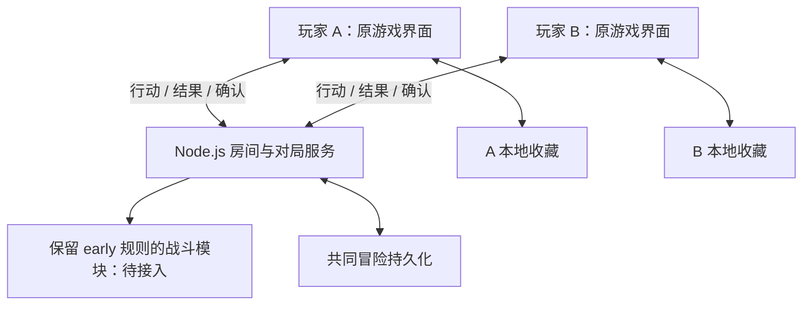

# PokéRogue Early 合作项目规格与进度

更新日期：2026-10-13。本文依据用户已确认要求和本地代码现状编写。

本文区分“目标需求”“当前实现”和“验收证据”。代码存在不代表正式游戏已经接入，实验测试通过不代表原版玩法兼容。后续文档与本文冲突时，以用户最新要求为准，并同步修正文档。

开发入口：[联机架构与接口](docs/coop-architecture-2026-10-13.md) · [分模块计划与进度](docs/coop-development-plan.md) · [新窗口交接](docs/DEVELOPMENT-HANDOFF.md)。M1 正式契约与真实 WS 双客户端测试已落实，范围见 [M1 记录](docs/coop-contract-m1-2026-10-13.md)；原版模型与运行器仍待 M2/M3。

## 1. 项目目标与开发边界

在选定的 early 原游戏基础上，保留单人玩法、原游戏画面、图鉴收藏与扭蛋系统，增加可以通过局域网或服务器进行的双人合作。每位玩家独立经营自己的队伍和资源，两人共同战斗并推进冒险。

| 项目 | 基线 |
|---|---|
| 工作目录 | `E:\pokeregue\pokerogue-early` |
| 项目仓库 | https://github.com/northstreet01/pokerogue-early |
| 原版来源 | `pagefaultgames/pokerogue` |
| 固定历史提交 | `ec9365a8bffd8fa0dc050e71ef3eb177e63bc1e9`，记录版本 1.0.0 |
| 基础提交 | `2499edd7`：early 离线基础及设计记录；后续审查提交以 Git 历史为准 |
| 原有新版目录 | `E:\pokeregue\pokerogue`，保留其代码和未上传内容 |

玩法兼容验收中的“原版”指上述固定 early 版本。语言切换等扩展功能则按用户最新要求，优先从上游已有实现移植并适配，不要求扩展也停留在 early 的实现方式。基线身份记录于 `BASELINE.json`；独立仓库不包含该上游提交对象，后续历史差分应使用匹配的原始源码或上游检出核对。

**必须遵守的边界：**

- 保留 early 已有的精灵、招式、成长、图鉴及战斗规则；仅调整用户明确确认的合作差异。
- 不以“减轻实现难度”为理由自行裁剪已有内容或另写简化规则来替代原游戏。
- 暂不追赶上游后来新增的复杂机制；这不等于授权删除 early 已有机制。
- 不改变图鉴数据语义，不新增永久精灵等级或永久个体仓库。
- 未接入原游戏的独立验证页，不得作为合作游戏已完成的交付。
- 不迁移、清空或覆盖个人存档来掩盖兼容问题；修复必须保留原数据。
- 语言切换等扩展功能优先复用原版实现、资源和数据约定，仅为 early 的接口、离线环境和画面作必要适配；不另造替代系统，不重写 early 独有文案。移植时记录来源、差异和验证范围，不借移植改动玩法或图鉴语义。
- 游戏未保存语言偏好时默认简体中文；保留已选择的语言，提供简体中文/英文切换。对应不上原规则的说明保留旧文案，不直接套用现代机制的翻译。

## 2. 已确认的玩法需求

| 编号 | 要求 |
|---|---|
| PLAY-01 | 支持创建房间、通过房间码加入，固定两名玩家。 |
| PLAY-02 | 每人从自己的收藏选择 3 只精灵，各上场 1 只，共同参与双打；后备队伍互相独立。 |
| PLAY-03 | 各自持有金钱、精灵球、道具，各自选择奖励和购买；一人的消费不扣另一人的资源。 |
| PLAY-04 | 共同推进战斗与冒险波次；战后双方完成整备并准备后才继续。 |
| PLAY-05 | 捕获在战斗中进行，成功后敌人离场，归捕获者所有，不向另一人增加捕获解锁。遇见记录仍按实际遭遇处理。 |
| PLAY-06 | 捕获个体进入捕获者的本局备用列表，战后可替换个人队伍。永久侧按原版更新收藏，本局备用列表随新冒险重置。 |
| PLAY-07 | 一人全部倒下时，存活玩家继续。过关后给倒下玩家恢复机会；已批准方案为第一只精灵恢复一半 HP。双方全灭则失败。 |
| PLAY-08 | 倒地后的强制替补在回合结束时处理，不由客户端自行插入行动。 |
| PLAY-09 | 普通攻击绑定目标位置。轮到行动时位置已空，则本回合行动失败，不自动改打其他目标，不扣尚未使用的 PP；若换人后新精灵占据同一位置，则攻击新精灵。 |
| PLAY-10 | 捕获绑定敌方具体实例。若目标已离场，后续捕获取消，不消耗尚未使用的球。 |
| PLAY-11 | 新冒险按 early 原版初始化等级等状态；Lv.5 是开局等级，不是永久收藏等级。实验页的 1000 金钱、5 球、2 伤药等数值不据此成为正式需求，须与原版核对。 |
| PLAY-12 | 保留单人游玩与本地存档能力。单人与合作最终复用经原版兼容验收的规则，不能让实验引擎直接替换单人。 |

合作导致原版无法直接适用的规则应单独列出差异与验收案例；未明确的差异不得用实验页的实现默认定案。

## 3. 原版图鉴与存档模型

### 3.1 永久收藏

`src/system/game-data.ts` 中的 `DexData` 按物种 ID 保存 `DexEntry`，是累计解锁记录，不是逐只精灵的永久仓库。

| 字段 | 含义 |
|---|---|
| `seenAttr` / `caughtAttr` | 见过/捕获过的属性位集合，包括普通/闪光、性别、特性槽与形态 |
| `natureAttr` | 解锁性格的位集合 |
| `seenCount` / `caughtCount` / `hatchedCount` | 遇见、捕获、孵化次数 |
| `ivs` | 六项分别记录累计最高个体值 |

系统存档还包括训练家身份、`starterMoveData`、`starterEggMoveData`、统计、解锁和成就、扭蛋券及未孵化蛋。它们继续遵守原版持久化语义。

捕获/孵化通过 `setPokemonCaught`、`setPokemonSpeciesCaught` 更新图鉴；个体值由 `updateSpeciesDexIvs` 更新。原版会向进化前物种递归更新相关捕获解锁和 IV。初始精灵选择界面使用这些数据决定可选物种、形态、性格、特性等。合作适配不能漏掉这些联动。

### 3.2 本次冒险

等级、当前 HP/PP、状态、队伍、金钱、背包、战场和波次属于冒险数据；合作新增的个人本局备用列表也属于这一层。继续同一冒险应恢复它们，开始新冒险则重新初始化。

### 3.3 保存职责

- 浏览器 IndexedDB `pokerogue-early-local`：个人系统收藏、单人槽位，以及合作授予去重记录和席位恢复凭据。当前实验收藏另存为 `coop-experiment-data`，账本另存为 `coop-experiment-grants`；实验结果不回写正式 `data`。设置和教程目前仍使用 localStorage。
- 服务器：共同对局状态、随机流、双方本局资源、待提交行动、回执、授予记录与检查点。
- 浏览器存档按访问来源隔离，`localhost`、IP 地址和域名对应不同存储；切换地址通过备份迁移，不能声称数据自动互通。
- 收藏结果及其去重记录必须同一事务落盘，成功后才确认，防止重连重复计数。
- 本地存档失败要显示错误并暂停相关推进，不以新空档覆盖旧档。
- 全量浏览器备份和服务器房间备份职责不同，不能互相替代。备份中的私有席位凭据不得公开。

## 4. 联机架构要求

采用 Node.js 独立服务与 WebSocket。参考 Stronghold-Protocol 的服务、房间和重连分层方向，不移植其战斗规则。本项目固定采用服务器权威结算。

这是两客户端连接同一权威服务器的 C/S 架构，不是浏览器直接 P2P。局域网可以由一位玩家的电脑运行服务器，但其浏览器没有额外裁决权。先预留并实现正式联机接口，提前接两端测试，不等单端引擎全部完成才接网络。

上图是目标结构。目前 A/B 为独立验证页，E 为有限实验引擎，不能与目标实现混同。

### 4.1 房间与部署

- 创建者是普通玩家席位，不因创建房间获得客户端战斗裁决权。
- 房间码在同一服务器内有效；另一台设备必须访问该服务器地址。
- 局域网由一台电脑运行 Node 服务；远程部署时双方访问同一远程服务。两者使用相同协议。
- 原席位用私有凭据恢复，不允许仅凭公开房间码接管已开始的玩家席位。
- 暂无跨服务器大厅、自动网络穿透、账户或竞技防作弊系统；不作为当前已完成能力。

### 4.2 防止不同步的必要约束

1. 服务器独自决定联机随机数、行动顺序、伤害、捕获、胜负和进度。客户端提交意图并展示结果。
2. 输入必须与当前对局、决策、状态版本和玩家所有权对应；使用唯一指令编号去重。
3. 房间状态修改串行执行，网络包抵达先后不得代替战斗速度与优先级规则。
4. 收齐本次决策需要的行动才结算；全灭玩家可无需提交战斗行动，但仍接收状态。
5. 结果和去重回执成功持久化后才广播；保存失败不发布未提交状态。
6. 两端应用完整状态、完成必要本地收藏写入并确认后，才开放下一次决策。
7. 确认必须对应当前版本；迟到的旧确认不能确认新状态，也不应误报为当前不同步。
8. 断线、当前状态校验失败或本地保存失败时阻止推进，不自动代选或跳过回合。
9. 动画完成时间与播放速度不能决定战斗结果；禁止靠动画回调自行推进权威战斗。
10. 协议、规则及内容版本不兼容时拒绝开局/恢复，保留存档并说明原因。

正式游戏接入后，校验要覆盖实际应用的战斗模型，不能只对收到的 JSON 校验就宣称画面与游戏状态已同步。双方结果一致也不代表规则正确，仍须与 early 原版进行差分验证。

### 4.3 标准流程

打开原游戏 → 选择单人或合作 → 创建/加入房间 → 各自选择 3 只 → 初始状态校验 → 各自选择行动 → 服务器统一结算 → 双方应用并确认 → 后续回合或战后整备 → 各自奖励/购物/换队 → 双方准备 → 下一战。

战后允许保存并暂停；恢复须双方回到原席位并校验。临时断线也暂停，恢复后继续同一待决策状态，不能重复消耗物品或重复发放收藏。

### 4.4 接口与检查点开发约束

- 先完成正式消息版本、运行时校验和适配接口：行动、回执、快照、实际模型确认、授予确认、状态请求、席位恢复；契约详见架构文档第 3 节。它们不等于当前实验协议已经具备的能力。
- 输入绑定对局、决策、预期版本与唯一动作 ID；身份来自连接。连接代次隔离旧连接晚到确认，版本拒绝不能清空旧存档。
- 完整检查点覆盖精灵与效果、个人本局资源、所有随机流、决策上下文、已收输入、去重回执及待授予。恢复不得直接给只读属性赋值或重复执行效果。
- 在安全决策边界保存，包含学习招式、进化等原版交互的适配清单；动画与函数 Phase 不能直接序列化。接受单方输入也先落盘，服务器重启后重新建立双端确认。
- 每个状态切片同时做单端原规则差分和双端实际模型恢复测试；共享与个人视图分别校验，语言/动画/在线/ACK 等显示或协调数据不进入共享战斗摘要。

## 5. 当前进度快照

下表截至本规格日期；“已实现”描述代码现状，不表示整个合作游戏交付完成。

| 模块 | 状态 | 证据与限制 |
|---|---|---|
| 独立 early 项目与公开仓库 | 已建立 | 基础提交 `2499edd7`；原有新版目录保留 |
| 原游戏单人入口 | 可运行基础 | `/` 或 `/index.html`；仍用原战斗引擎，完整单人流程未验收 |
| 原版语言系统适配 | 首批接入 | i18next、上游中英资源与字体、`prLang`；默认简体中文，设置切换后刷新生效，尚非全量汉化 |
| 本地收藏及单人存档 | 已接入基础 | IndexedDB、3 个单人槽位、备份工具；完整扭蛋/孵化流程未验收 |
| Node.js 独立服务 | 已实现基础 | `server/start.mjs` 提供构建网页及联机服务 |
| WebSocket | 已实现基础 | `/coop/ws`、心跳、断线检测、消息处理 |
| 双人房间 | 已实现基础 | 建房、六位房间码、两席、提交队伍、私有凭据重连 |
| 对局协调 | 已实现基础 | 房间串行、指令去重、版本检查、快照与双端确认 |
| 服务端恢复 | 已实现基础 | JSON 原子写盘、重启加载；需保留服务器文件 |
| 独立合作验证页 | 实验可运行 | `/coop.html`，不是原游戏合作界面 |
| 原版战斗接入服务器 | 未完成 | 当前服务调用 `src/coop/engine.mjs` 有限实验规则 |
| 原版规则分离 B1 | 首批完成 | `src/battle-core/` 提取原随机流、野生等级/等级上限和捕获判定，并接回原单人；尚非完整引擎 |
| 原版状态检查点 B2 | 首批组件完成 | 覆盖原战斗/场地标签、异常状态、天气/场地和 Battle 随机流；完整精灵状态、决策与行动队列仍待接入 |
| 正式联机接口与提前双端验证 M1 | 契约及协议层已验收 | `/coop/v1/ws`、运行时校验、适配接口、12 项协议测试；两个独立测试模型已应用/提取确认，原 Pokemon 适配尚未完成；默认缺运行器拒绝开局 |
| 原游戏选队、战斗、整备界面接入 | 未完成 | 不能把验证页冒充完成 |
| 个人奖励/商店/备用队伍 | 仅实验实现 | 原游戏内的适配与规则兼容未完成 |
| 合作收藏更新 | 已隔离，兼容仍未完成 | 审查后只写独立实验副本；实验路径仍缺少原版进化链捕获/IV 联动，不作为正式实现 |
| 单人与合作共用原版规则 | 未完成 | 原单人引擎和实验合作引擎相互独立 |
| 合作中的蛋进度和券奖励 | 未接入 | 保留单人代码不等于合作流程已经兼容 |
| 双机长期回归 | 未完成 | 现有实测为同一机器两个浏览器来源 |

### 5.1 已发生的范围偏差

实验引擎自行限定 10 种精灵、14 个招式、10 波、等级上限 10，并省略特性、进化等原版机制。这些是实现偏差，**不是用户批准的玩法需求，也不是正式开发目标**。`BASELINE.json` 的相应字段目前描述实验能力；`coopAvailable: true` 不表示原游戏合作已经可用。

实验收藏更新复用了原存档字段，但未完整复用原版行为。审查后改为只在首次连接读取正式收藏，后续只更新独立实验副本，且拒绝跨训练家覆盖；历史正式记录不自动回滚。当前不得声称其图鉴兼容已经完成，也不能通过改原版图鉴来迁就实验引擎。

### 5.2 已有验证记录

此前记录：类型检查通过，21 项合作测试和 6 项存档测试通过，生产构建通过；同机双浏览器验证了建房、第一波战斗、独立购物/奖励、保存恢复以及进入第二波。独立生产服务做过网页与 WebSocket 建房检查。

上述证据只覆盖当时的基础与实验实现。后续代码审查新增了异常帧隔离、写盘失败强制暂停、连接更换期间确认隔离、实验收藏隔离及一致备份的回归用例；本次验证结果记录于 `docs/code-review-2026-10-13.md`。尚无真实双机长时间对局、原版全机制差分、实际浏览器成功捕获入库和完整扭蛋流程的验收证据。

B1 增加 `npm run test:battle-core`：直接对照基础提交保存的原函数，验证随机数输出与状态、波次 1–1000 的等级生成、等级上限及捕获随机消费。依赖梳理、实际变更与未解决项见 `docs/original-battle-integration-2026-10-13.md`。这些局部对照不代表完整战斗已经兼容。

B2 增加 12 项状态测试，覆盖全部原战斗/场地标签字段与 prototype、典型效果恢复后继续执行、错误状态拒绝和随机流续取；合计 58 项自动测试通过。范围和证据见 `docs/original-state-checkpoints-2026-10-13.md`，尚非完整对局恢复验收。

语言适配增加 5 项测试，检查默认语言、偏好持久化、同步初始化、命名空间/插值、旧规则说明回退和已接入的固定语言键。来源和本轮检查见 `docs/upstream-localization-2026-10-13.md`。

### 5.3 提交状态

M1 本批起点 `df9eb8bf`；正式契约、客户端消费器、隔离服务及 12 项协议测试已在工作区完成，随本批提交；未推送。原有 63 项回归与新增测试共 75 项通过，类型检查通过；构建及覆盖边界见 [M1 记录](docs/coop-contract-m1-2026-10-13.md)。

基础提交为 `2499edd7`。用户随后要求审查并推送，本规格、房间服务、实验页面和审查修复纳入同一次交付；具体提交和远程状态以 Git 历史及推送核验结果为准。个人存档和服务器房间数据不纳入提交。

房间基础、规格及存档保护修复已于 `cc5557e2` 推送至 main；B1 原版规则分离已于 `cb6afc2d` 推送，B2 首批组件检查点已于 `3adfe471` 推送。语言移植与适配已于 `d860f601` 推送。本轮联机排期、架构及交接文档提交号以 Git 记录为准。

## 6. 后续实施顺序

用户最新安排：**接口先行、提前双端测试、逐模块补齐原版规则**。M1 契约及双客户端协议测试已完成；下一批做 M2 完整检查点、再做 M3 原版运行器。M4 原游戏战斗 UI、M5 个人整备、M6 原版收藏按切片接入。M7 持久化/重连故障验证从 M1 贯穿开发，M8 完成双机与发布验收。详细状态、依赖和门槛见 [模块计划](docs/coop-development-plan.md)，不把它们全部归为模糊的“阶段 B 进行中”。

| 阶段 | 工作 | 完成条件 |
|---|---|---|
| A：纠正范围与保护存档（部分完成） | 已明确实验边界、将实验写入隔离；待建立完整原版行为对照 | 不再用实验规则定义产品；独立副本与旧档保护通过测试，原版兼容须另行验收 |
| B：原版规则适配（B1、B2 首批完成） | 已提取原随机流、等级与捕获判定及效果状态检查点；待补齐完整决策状态、回合排序、伤害/特性副作用及完整运行器 | 局部原版差分通过后继续扩充，完整阶段仍要求可执行的服务器原规则战斗，无擅自数值简化 |
| C：原游戏联机闭环 | 接入原游戏选队、行动菜单、战斗展示、强制替补、个人整备 | 双方在原游戏画面完成选队、一场共同战斗、独立奖励/购物并进入下一战 |
| D：收藏及续局完整性 | 原版收藏语义、合作蛋/券进度、事务去重、版本恢复 | 捕获/孵化与进化链联动正确，重连不重复授予，备份恢复不覆盖新收藏 |
| E：正式验收 | 双机、长局、断网、重启、异常存储、单人回归 | 满足下一节验收项，明确记录仍不支持的合作差异 |

可以分步骤接入和验证原版机制，但“尚未接入”必须作为未完成项保留，不能静默转换成正式玩法删减。沿用服务器权威结算方向；原版规则与 Phaser 如何切分仍需实际分析，不把新写一个简化引擎当成既定答案。

## 7. 验收标准

- [x] **CONTRACT-01** 正式协议及版本校验、运行器/检查点/客户端适配接口落地；真实 WS 双客户端从第一批接入，未实现适配器明确拒绝；实验与正式规则隔离。证据见 M1 记录，仅协议与测试模型验收，不含原版适配实现。
- [ ] **CHECKPOINT-01** 完整原版状态在安全决策点保存恢复；单端不中断与恢复后继续的结果、事件及随机消费一致；双端从实际应用模型提取摘要，故意损坏一端可阻止推进。

- [ ] **GAME-01** 两台设备在原游戏画面中建房、各选 3 只、各上场 1 只，完成共同战斗及下一波；不是独立卡片验证页。
- [ ] **RULE-01** 已接入的伤害、命中、顺序、PP、状态、特性、成长、捕获和进化行为与固定 early 版本一致，明确合作差异除外；保存对照案例和结果。
- [ ] **OWN-01** 购物、奖励、使用物品和换队只改变所属玩家资源，不能操作另一人的精灵或余额。
- [ ] **TARGET-01** 覆盖目标被捕获、目标被击倒、同位置换人、两人捕获同一敌人，符合 PLAY-09/10，不重复扣 PP/球。
- [ ] **FAINT-01** 覆盖强制替补、个人全灭继续、过关恢复及双方全灭；无客户端自行跳过决策。
- [ ] **DEX-01** 捕获/孵化更新原字段、统计、性格/形态/特性解锁及进化链 IV；重复消息与重连不重复计数，队友不获得不属于自己的捕获。
- [ ] **RESET-01** 新冒险保留原版永久收藏、券及蛋，重置本局等级、状态、资源、队伍进度及备用列表。
- [ ] **SYNC-01** 不同输入到达顺序、重复包、旧版本包和迟到确认不改变合法结果；实际应用后的双方战斗模型一致。
- [ ] **SYNC-02** 模拟哈希错误、单端存储失败、服务器写盘失败及任一玩家断网，均不能带着不同状态继续；恢复后结果不重复结算。
- [ ] **SAVE-01** 战后保存退出、浏览器关闭、服务端重启后可恢复原席位与同一局；凭据和对局版本校验有效。
- [ ] **SOLO-01** 原单人选队、存档、捕获、成长、扭蛋与孵化回归通过，合作不会覆盖个人新收藏。
- [ ] **DEPLOY-01** 在真实两台设备上验证局域网，并验证同域远程部署的 HTTP/WebSocket 链路；提供实际运行记录。
- [ ] **RELEASE-01** 发布内容排除个人存档、房间凭据、服务器 data、环境秘密、依赖和临时构建/审计产物；保留许可证。

## 8. 尚需明确的合作细节

以下不阻止梳理原版与接入房间基础，但在相关功能落地前需明确，不能沿用实验实现当作用户决定：

- 共同战斗的经验归属与分配：保留原版公式，明确哪些个人队员参与分配；实验引擎的简化均分不是批准规则。
- 原版地图分支、训练家/Boss 或其他全局选择出现时，双方如何共同决策。
- 合作中蛋孵化推进与券奖励的归属和发放时机，保持各自收藏独立。
- 敌我同回合全部倒下等边界的最终判定顺序：实验引擎目前判失败，正式行为须对照原版及合作约定确认。
- 战后各自菜单的并行程度：当前每次个人操作都会触发双方确认；资源独立已验证，流畅的并行整备尚未完成。

## 9. 实现与文档索引

| 路径 | 用途 |
|---|---|
| `server/coop-service.mjs` | 房间、WebSocket、协调、持久化 |
| `server/start.mjs` | 独立 Node HTTP/WebSocket 服务入口 |
| `src/coop/engine.mjs` | 有限实验规则，不作为正式原版规则替代品 |
| `src/coop/client.mjs`、`coop.html` | 独立实验客户端 |
| `src/coop/local-profile.ts` | 独立实验收藏写入；原版兼容仍待实现 |
| `src/coop/snapshot-sync.mjs` | 连接有效性、快照校验与存储后确认 |
| `src/battle-core/` | 从原版提取并回接单人的共享纯规则，首批随机数/等级/捕获 |
| `docs/original-battle-integration-2026-10-13.md` | 原战斗依赖、B1 进度与后续切分边界 |
| `docs/original-state-checkpoints-2026-10-13.md` | B2 效果/随机组件检查点、覆盖证据与完整决策状态缺口 |
| `src/system/game-data.ts` | 原版图鉴和系统/冒险数据接入 |
| `src/system/local-save-store.ts` | IndexedDB 与事务、备份、防覆盖 |
| `src/ui/starter-select-ui-handler.ts` | 原版初始精灵选择 |
| `COOP.md` | 实验运行方法与实际限制 |
| `LOCAL-FOUNDATION.md` | 已有验证及历史工作记录 |
| `docs/coop-architecture-2026-10-13.md` | 当前目标架构、正式消息与适配接口约定、恢复时序；明确尚未实现部分 |
| `docs/coop-development-plan.md` | M1–M8 模块进度、依赖、测试层级与验收门槛 |
| `docs/DEVELOPMENT-HANDOFF.md` | 新窗口工作目录、阅读顺序、代码现状与第一项任务 |

维护约定：每次交付同步更新第 5 节进度与第 7 节验收，附测试范围和已知限制；不得只改完成标记而没有实际证据。
