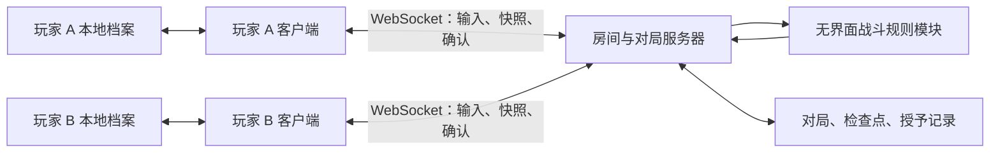
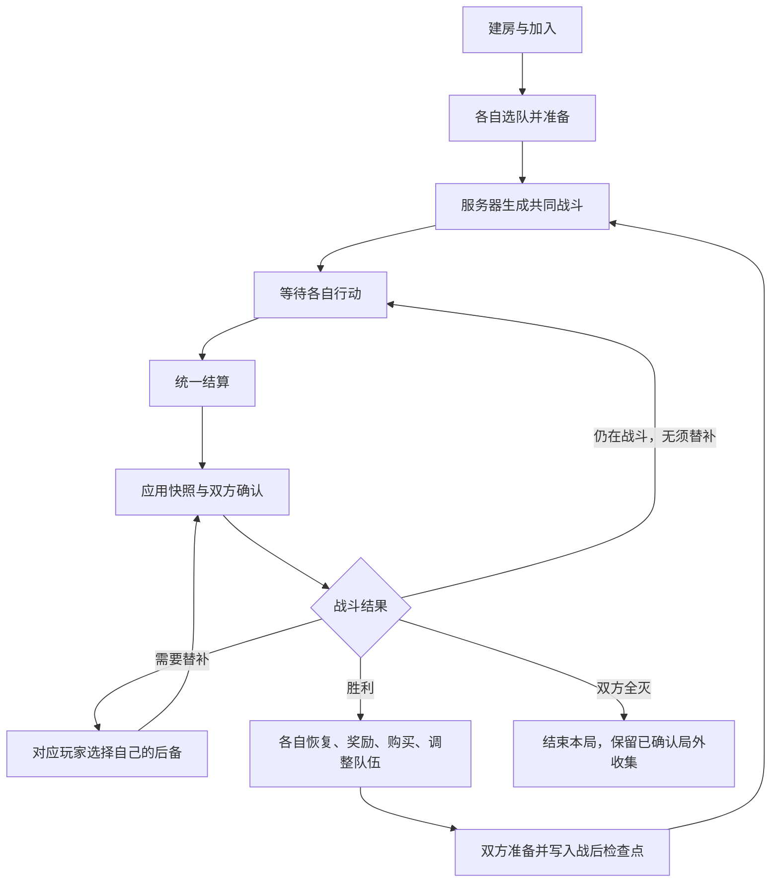

# 联机层架构与玩法流程：已批准方案

日期：2026-10-13。用户已批准实施。本文是完整目标设计，不表示所有阶段均已完成；当前实现范围见 COOP.md。

## 目标与现状

目标是两位玩家各自收集、选队、持有金钱和道具、选择奖励和购买，只有战斗与冒险进度共同推进。每人 3 只、各上场 1 只。捕获归捕获者，敌人离场，战后才替换队伍。一方全灭后另一方继续，胜利后提供恢复机会。

现有 early 项目已具备早期单人游戏和本地存档接入；尚无本方案要求的无界面战斗模块或新合作服务器。按用户最新要求，局外沿用原版单人的图鉴/初始精灵收集模型，不新增永久等级养成或逐只精灵实例仓库。因此本方案包含战斗分离和合作适配工作，不能把现有旧版阶段文件直接搬到服务器当成已实现。

## 架构

参考 Stronghold-Protocol 的独立服务、建房/加入/准备、原席位重连以及前后端共用模拟模块的分层方式。其当前 README 提供 `SP_COMBAT=client`（默认浏览器模拟）和 `SP_COMBAT=server`（服务器模拟并推流）两种模式；本提案固定采用服务器结算方向，不让双方独立计算共同战斗结果。此处是参考方向，尚未移植其代码。参考：https://github.com/sganggs/Stronghold-Protocol#端口与配置 。

### 模块职责

| 模块 | 负责 | 边界 |
|---|---|---|
| 本地档案 | 原版图鉴/初始精灵收藏、捕获数量与属性、扭蛋及局外存档 | 完整收藏不上传，进入房间只提交所选队伍和必要数据 |
| 客户端 | 菜单、行动选择、个人整备、画面、声音、本地授予入库 | 不决定联机伤害、命中、捕捉或胜负；动画不修改权威状态 |
| 房间服务 | 创建/加入、席位、选队、准备、开始、恢复原席位 | 建房者只管理房间；断线不会将结算权转给另一客户端 |
| 对局协调器 | 行动去重、所有权验证、状态版本、决策等待、确认屏障 | 每个房间的状态改变串行执行，超时不替玩家选择 |
| 战斗规则模块 | 数值、目标、顺序、随机数、捕捉、倒地和胜负 | 不依赖 Phaser、DOM、动画、网络或真实时间；单人和联机共用 |
| 个人整备模块 | 各人的奖励、商店、余额、道具、战后替换 | 钱和选择互不共享；两人都准备才进入下一战 |
| 服务端持久层 | 已确认状态、恢复信息、行动回执、检查点、授予去重 | 只保存本局相关队伍与记录，不代替局外收藏服务器 |

浏览器端与服务器端共享类型、版本和规则数据。联机时只在服务器运行战斗模块；单人时本地运行同一模块，复用相同的决策协议。原有 early 单人入口在新模块验收前保留，最终再切换到共用规则模块。

局域网和部署服务器使用同一协议。局域网是一台电脑运行服务、两台设备连接其地址；部署服务器则连接配置的服务地址。浏览器收藏随原有访问来源保存，通过备份导入导出迁移。局域网也必须有服务进程，浏览器创建房间不会自动启动独立服务器。

## 状态结构与同步

### 明确的数据边界

服务端保存可序列化的对局状态：双方全部队伍及稳定实例 ID、场上槽位、HP/PP/状态计数/能力阶段、双方金钱和物品、本局新捕获记录、敌方、波次、回合、待决策内容、待执行动作与随机流状态。

客户端保存自己的渲染模型；不将网络字段按名称写回原版 Pokemon 实例，也不修改原版 Phase.end 来推进网络流程。

共享战斗快照是双方相同的公开数据。个人商店候选等可以只发给对应玩家，对其单独计算个人视图摘要，不把不同玩家的个人视图互相比较。随机流由服务器保存；战斗、每人的奖励和商店使用独立随机流，局外扭蛋与它们无关。

### 输入和结算

1. 握手比较协议、规则与内容版本，不一致不能开始或恢复。
2. 输入携带 runId、decisionId、expectedRevision、actionId 和玩家席位；所有权由连接身份判断，不相信输入自行声明的角色。
3. 合法输入被服务端确认后锁定；断线重发相同 actionId 返回原回执，不再次执行。同一动作 ID 携带不同内容则拒绝。不同旧动作 ID 或旧状态版本也拒绝。
4. 收齐当前所需玩家的输入后统一结算。已全灭玩家无须交行动，但仍接收状态并确认。
5. 服务器按规则确定顺序，不使用网络输入到达时间。得到下一个完整决策状态后，先持久保存状态、回执和授予记录，再广播事件与快照。
6. 客户端按稳定 ID 应用新状态、播放事件，计算实际应用后的公开状态摘要，并确认 revision、decisionId 和摘要。
7. 两端完成对应确认后才开放下一次决策。确认位图和连接状态属于协调信息，不混入会因单端确认而改变的战斗摘要。

事件服务于显示与诊断；快照决定状态。动画不同步完成不改变战斗结果。客户端不能用动画回调触发服务器结算，也不能因动画跳过而少应用一部分状态。

摘要不一致则锁住输入，重新下发完整快照；仍不一致则停止推进并记录错误。服务器规则本身也必须测试，因为双方一致不能证明伤害或捕捉规则正确。

### 对局状态机

断线暂停可以发生在任何节点；它保留原来的决策状态，不创建另一个回合。暂停状态不清空已确认输入或重新随机结算。

## 玩家看到的完整流程

### 1. 局外

打开本地档案，查看原版图鉴与初始精灵收藏，使用个人扭蛋资源。捕获和孵化更新原版收藏数量、解锁与属性数据；不另做永久等级培养或逐只实例仓库。扭蛋消耗和获得的蛋在一笔本地事务内保存。

新冒险遵循原版单人规则重新生成本局状态，保留已收集的精灵种类、数量、合法个体值、性格及其他原版收藏/解锁属性；上一局的等级、HP/PP、金钱、道具和场地进度不带入新冒险。Lv.5 只是当前 early 默认的开局战斗等级，不是新设的局外等级。本局精灵仍有稳定 ID，但不将该 ID 变成永久养成实例。

原版 SystemSaveData 还保存扭蛋券和未孵化蛋，按“局外与原版单人相同”的要求继续保留；它们与本局金钱、精灵球及道具分开。若用户希望连这些原版局外资源也在新冒险清空，需要另行明确，此提案不默认清空。

### 2. 房间与选队

选择服务地址，创建房间或输入房间码。两人分别从自己的原版初始精灵收藏选择 3 只和首发，各自遵循原版选队/属性规则；不同玩家可以选择相同物种。服务器为本局精灵生成稳定 ID。

服务器校验支持的物种、字段和招式范围，构造本局状态。修改队伍取消自己的准备；两人准备且版本匹配后房主可以开始。

### 3. 战斗

双方各有自己的一个行动。首版支持攻击、主动换人、对自己队伍使用受支持的消耗道具、捕捉。

支持的目标、PP、物品数量及换人合法性都由服务器检查。捕捉只占捕捉者自己的行动，队友的合法行动继续执行。

建议首版按回合结束进行倒地替补，未上场的后备不承接同回合已指定给倒下精灵的后续攻击。需要替补时，只向精灵所有者开放后备选择，对应状态确认后才进入下一回合。双方同时需要替补时各自选择，服务端收齐后一起应用。

身份和归属使用稳定实例 ID。目标按招式/操作语义区分：普通攻击面向合法战场槽位，捕捉面向指定的野生精灵实例，个人物品面向自己的精灵实例；不将临时队伍数组下标当作身份。

### 4. 捕捉与目标冲突

双方同回合捕捉同一目标时，依行动规则及战斗种子确定先后，与网络延迟无关；第一人成功后，第二人的捕捉取消且不扣球。第一人失败而目标仍在场，第二人的捕捉正常执行。

根据用户询问后的源码核对，修正此前“一律取消离场目标动作”的表述：当前 early 的 MovePhase 根据战场槽位查找有效目标，找不到目标时取消该动作，PP 扣除在取消判断之后。普通单体攻击遇到敌方主动换人时，目标槽位仍有合法精灵，应攻击换入者，不因原精灵离场就取消。

建议首版保持该 early 目标规则：原目标倒下或被捕获且其槽位没有有效目标时，原动作取消且不扣未使用的 PP；不会默认为所有招式自动改打另一只。若用户希望普通单体攻击自动转向剩余敌方，可作为明确批准的玩法调整，由服务器统一选定目标；不将此行为误称为当前 early 已有机制。

捕捉不会自动改抓另一只：指定野生精灵已被先捕获时，后一个捕捉动作取消且不消耗球；敌方全部离场时按战斗结束处理。友方物品和特殊目标招式按各自目标语义验证。以上细则已批准；当前阶段支持范围见 COOP.md。

动作是在结算过程中因目标消失而取消时，该精灵的本回合行动已结束，相当于本回合没有出招；不能在同一回合重选一次行动。整个合作回合继续处理其他合法动作，下一回合可重新选择。提交时就不合法的输入则由服务器拒绝，允许在尚未开始结算前重新选择，两者不能混为一谈。

成功捕获同时确定球消耗、敌人离场及唯一授予记录。捕获者将原版图鉴/收藏数量与属性更新原子写入本地；重发相同授予 ID 不重复领取。捕获精灵另进入本局备选列表，个人 3 只队伍不在战斗中替换，战后才可从该列表替换。本局备选列表随冒险存档，不是永久实例仓库。

### 5. 全灭与胜负

一人的队伍全灭后进入观战，不再提交行动。另一人的行动正常进行，敌方下一次合法决策只选可行动的目标。观战玩家仍接收、确认同步状态。

建议共同胜利后，全灭玩家可免费选择一只精灵恢复至 50% HP，随后正常整备；不会因个人没钱而永远无法准备。

双方队伍全灭时本局失败；建议同一个结算边界上敌我同时全灭也判本局失败，避免循环奖励或不明确结局。已确认并入库的捕获和局外奖励保留。

### 6. 个人整备

双方各自获得完整基础过关金钱，不按击杀归属分割一个公共钱包。各有独立奖励候选和商店，可选择奖励、买物品、治疗、整理道具或替换本局捕获的精灵。

局内金钱和局内道具属于这次冒险；扭蛋资源、仓库和图鉴永久保存。首版不做跨玩家交易、共用道具或共享钱包。

一人完成整备后点击准备等待，另一人继续操作。两人都准备后冻结整备状态，确认当前版本与待保存授予，写入战后检查点，进入下一场。进入冻结前可取消准备；冻结后不再接受购买。

建议战后不能任意从全部局外仓库调入新的满血精灵，只能整理原队伍及本局新捕获实例，避免无限换队绕过本局消耗。

### 7. 暂停、重连与继续

连接断开时立即停止接收新的决策输入；已经提交的一次完整结算事务可以完成并落盘，但不得在失去双方确认后继续推进。

重连凭据恢复原玩家席位，不以房间码代替席位身份。服务端下发最新已提交的完整状态、未完成决策和未确认授予；双方同步并确认后继续。不会重新抽本回合随机数。

主动保存退出的入口放在战后检查点，需要双方同意。继续时双方使用原来的本地档案与席位凭据连接该服务器。服务器保留本局所选队伍和授予回执，客户端保留本地收藏及恢复定位信息。

服务器持久保存已提交决策状态，用于异常恢复；这不承诺恢复到动画播放的具体一帧。首版不提供任意中途选择“另存档再读档”的入口，也不做房主迁移。换服务器时若要继续旧局，需要显式迁移对局存档，不靠个人收藏备份自动实现。

## 本地授予的可靠性

客户端本地更新原版收藏和图鉴时，需要一个专门的档案事务接口，将 grantId 去重记录与收藏数量/属性/资源变更一起提交；不能分别调用多次当前 writeLocalSave 后假定整体成功。

服务器先提交授予日志，再通知客户端。客户端本地事务完成后确认该授予。客户端断线或入库失败时，服务器保留待确认记录以供重发；重复确认不影响余额。客户端存储不可用时暂停其整备准备，不静默丢掉已获精灵。

备份应包含档案 ID、原版图鉴/初始精灵收藏、原版局外资源、已领取授予 ID，以及合作恢复定位信息；本局备选精灵属于对局存档。凭据与个人存档仅保存在用户设备/对局服务器，不提交到公开仓库。

## 首版支持范围与实现顺序

保留普通属性、属性克制、HP/PP、普通伤害招式、主动换人、倒地替补、基础捕捉、常用治疗与复活道具。异常状态和特性按清单逐项增加，未实现的招式/特性必须明确显示不支持，不能静默使用错误规则。

融合、Mega、极巨化、太晶、特殊遭遇、挑战模式、交易、自动跨设备收藏同步不在首版范围。地图推进首版为服务器生成的线性共同进度，避免另外引入地图投票系统。

1. 固定支持清单并实现实际可测试的无界面战斗模块；核对早期原版数值、顺序、PP 与捕捉规则。
2. 完成原版收藏模型的合作适配与原子授予、首发/后备选择、单人调用该模块。
3. 接入房间、队伍、准备、严格行动版本与完整状态确认；真实双端固定双打验收。
4. 接入个人奖励/商店、捕获归属与战后替换、一方全灭后的恢复。
5. 接入对局持久化、断线重连、战后退出与继续，完成异常与长对局验收。

以阶段验收控制扩展范围，不整套移植当前新版 LAN 补丁；不把只有界面的房间或 mock 协议测试称为已经可玩的联机版本。

## 必须验收的场景

- 双方不同操作速度、同时输入、重复发送、过期决策和错误席位输入。
- 完整状态在双方确认前不能推进；故意损坏客户端状态可触发重发或暂停。
- 同目标捕捉先成功/先失败、捕获导致敌方全灭、捕获后目标行动取消。
- 先行动击倒目标、双方同时倒地替补、一个队伍全灭、敌我同边界全灭。
- 两人各自购买、余额与道具不串用、一人先准备另一人继续整备。
- 断线发生在输入前后、服务器提交后客户端收到前、捕获入库前后、奖励入库前后。
- 本地入库失败、重复授予、服务器重启、原席位重连、战后退出再继续。
- 连续多场的实际引擎与浏览器双端验证；对伤害/PP/捕捉本身另做规则回归。

## 本轮请用户确认的具体规则

1. 按用户最新要求，局外沿用原版单人收藏模型，新冒险重置本局等级/HP/PP/钱/道具等；Lv.5 为 early 已有默认起始等级，不新增永久等级养成。
2. 首版倒地替补在回合结束进行；普通攻击优先保持原版目标规则，捕捉锁定指定实例，先被捕获则取消后一个捕捉且不扣球；同目标捕捉顺序不看网络先后。不同招式的目标转移条件按原版核对。
3. 全灭的一方在共同胜利后可免费复活一只至 50% HP；双方全灭或同边界敌我全灭判失败。
4. 战后只能用本局新捕获的实例替换队伍，不任意从局外仓库无限换入满血精灵。

以上目标已批准并开始实施。完整目标尚未全部完成，当前阶段实现与限制见 COOP.md。
