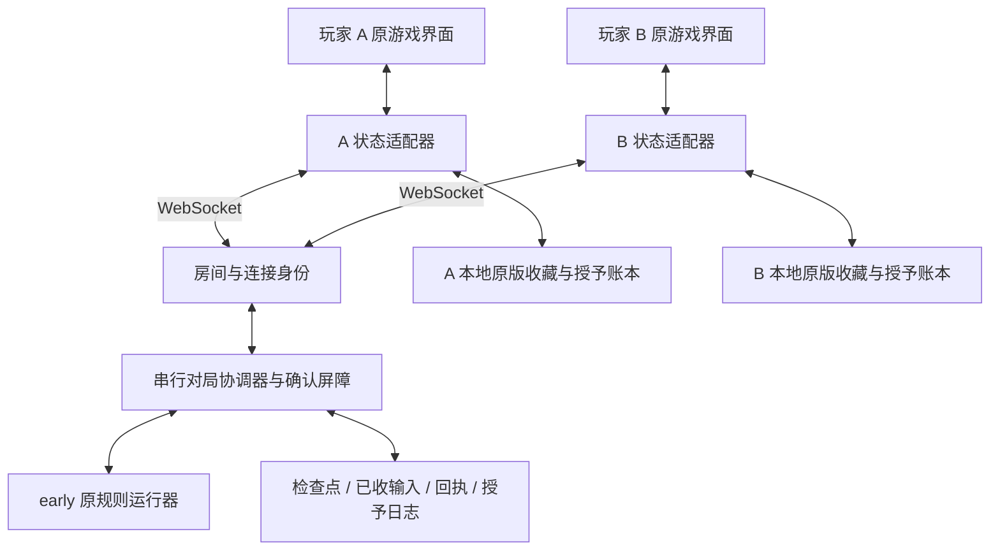

# 双人合作架构与接口约定

2026-10-18 首发实施细化见 [最快双端可玩架构](mvp-delivery-architecture-2026-10-18.md)。该设计复用本文和已实现 M1/M2，明确八方法桥、真实初始化、私有模型／事件、模型 ACK 与动画分离、基础持久化和两设备验收；不是已经实现或替换现有契约的声明。代码基点 92f43a32 仍缺正式原类 adapter。

更新：2026-10-13。需求以 SPEC 为准；模块排期见 [开发计划](coop-development-plan.md)，新窗口入口见 [开发交接](DEVELOPMENT-HANDOFF.md)。本文替换早期提案中裁剪原版内容、最后才接双端的过时安排。

本文描述目标架构与接口约定。M1 已实现共享契约、校验、隔离正式服务和双端协议测试，见 [M1 记录](coop-contract-m1-2026-10-13.md)。原版完整运行器与模型尚未接入；现有实验服务仍调用实验引擎，正式服务默认拒绝缺适配器的开局。

## 1. 连接方式与权威边界

采用 **两客户端 + Node.js 权威服务器 + WebSocket**，不是浏览器直接对等结算的 P2P，也不采用双方各自模拟后仅比较种子的方式。参考 Stronghold-Protocol 的独立服务、房间和重连分层方向；本项目没有移植其战斗代码，不依赖其后续版本变化。

局域网由一台玩家电脑运行 Node 服务，两端连接该电脑；远程模式两端连接同一部署服务。建房者仍是普通席位，断线不把结算权转交给另一浏览器。房间码定位房间，私有凭据恢复原席位。打开网页不会自动启动 Node 服务。

服务器决定行动顺序、随机数、命中、伤害、捕获和胜负。客户端展示快照与事件、提交玩家意图；动画快慢不推进权威状态。每局隔离全部规则随机源，保留原版消费顺序，不能为了分流随机数擅自改变结果；局外扭蛋与共同战斗分离。

原单人继续使用现有可运行路径。逐步提取原规则并回接单人，经过差分验证后才共用完整运行器；不能把有限实验引擎替换进去。early 已有特性、异常、形态、融合、Boss 等内容均需保留，未适配登记为未完成，不变成玩法删减。

## 2. 模块边界

| 模块 | 负责 | 边界 |
|---|---|---|
| 连接与房间 | 建房、加入、私有席位恢复、心跳、连接代次 | 不相信客户端声明的席位；凭据不广播给队友 |
| 协议与协调器 | 版本、指令去重、合法决策、串行处理、确认屏障 | 网络到达顺序不能替代游戏行动顺序 |
| 原规则运行器 | 执行到下一个安全决策点、返回状态与展示事件 | 不依赖网络、DOM、动画回调或真实时间裁决 |
| 检查点适配器 | 显式捕获、校验、还原完整模型和随机状态 | 不直接 JSON 化 Phase；不批量向 Pokemon getter 赋值 |
| 原游戏客户端适配器 | 菜单意图、原模型应用、实际状态摘要、事件展示 | 不自行扣血、扣球、判胜或抽取战斗随机数 |
| 个人整备 | 各自队伍、库存、金额、奖励和购买 | 不共享余额、不操作队友精灵；双方准备后进入下一战 |
| 本地收藏适配器 | 原版捕获/孵化/IV/进化链语义与事务去重 | 不新增永久个体等级仓库；不覆盖已有收藏 |
| 持久层 | 本局状态、已收输入、去重回执、待授予记录 | 先持久化后发布；失败不能带着内存新状态继续 |

## 3. 接口先行：M1 必须首先落地

以下名称是正式契约，**不是实验协议字段**。M1 已建立共享类型、运行时校验、适配接口及真实 WebSocket 双客户端测试入口，并隔离两个协议。原版动作清单及检查点 payload 随 M2/M3 补齐；TypeScript 类型不能代替网络输入校验。

### 3.1 身份与版本

- `roomId` 定位房间，`runId` 标识冒险，`decisionId` 标识当前决策，`revision` 标识已提交状态。每次重新开放新的可提交决策使用明确标识，不能只靠回合数。
- 握手比较 `protocolVersion`、`rulesVersion`、`contentHash`；恢复另比较 `checkpointVersion`。不兼容拒绝开局/恢复并保留数据，不静默补默认值。
- `connectionEpoch` 由服务器为当前席位连接生成；替换连接后旧异步回调、旧确认无效。重启后也不得复用旧连接身份。
- 席位由已认证连接导出。浏览器发送的 `seat` 不能授权操作；恢复凭据只用于私有恢复流程，不进入公开状态、普通日志或测试夹具。

### 3.2 消息契约

| 方向 / 消息 | 必要内容 | 约束 |
|---|---|---|
| 双向 hello / welcome | 兼容版本；成功后分配的席位与连接代次 | 版本通过后才允许参与对局 |
| 客户端 createRoom / joinRoom / resumeSeat | 昵称、房间定位或私有恢复凭据 | 创建/加入与恢复已有席位分开校验 |
| 客户端 submitAction | roomId、runId、decisionId、expectedRevision、actionId、action | action 是原版决策意图；服务器验证所有权、目标和合法选项 |
| 服务器 actionReceipt | actionId、接受/拒绝、决策与版本、稳定原因码 | 接受前输入与回执必须落盘；相同 ID 同内容返回原回执，不再执行；同 ID 不同内容拒绝 |
| 服务器 snapshot | 版本、roomId/runId、revision/decisionId、共享状态与摘要、个人视图与摘要、展示事件、待授予列表 | 仅发布已提交结果；个人视图单独比较，凭据不混入快照 |
| 客户端 stateAck | 当前连接代次、runId、revision、decisionId、实际应用后共享/个人摘要 | 应用成功且本地必要事务落盘后才发；不是照抄收到的摘要 |
| 客户端 grantAck | runId、已落盘 grantId 列表 | 验证授予所属玩家；重复确认无副作用 |
| 客户端 requestSnapshot | 已知 runId/revision、恢复原因 | 只请求权威状态，不能上传客户端状态覆盖服务器 |
| 服务器 syncStatus / error | 等待席位、在线情况、暂停原因、可恢复错误码 | 协调信息不进入共享战斗摘要；不触发自动代选 |

整备、选队、强制替补也使用具有版本与去重约束的决策意图。具体 action 联合类型由原版合法决策清单产生，不先用实验 14 个招式定义正式规则。目标区分位置与实例：普通攻击遵循 PLAY-09，捕获遵循 PLAY-10。

### 3.3 预留的代码接口

M1 契约位于 `src/battle-core/coop-contract.mjs`，客户端消费器位于 `coop-client.mjs`；正式协调器为 `server/formal-coop-service.mjs`，与实验 `server/coop-service.mjs` 分离。检查点 payload 和运行器仍待原版适配，职责不能合并成另一套简化战斗。

| 接口职责（建议名称） | 输入 → 输出 | 验收重点 |
|---|---|---|
| createInitialContext / describeDecision | runId → 初始决策上下文；上下文 → 决策 ID 与所需席位 | M1 已定义接口；原版选队等初始停点待 M2/M3，不能自动创建简化战斗 |
| validateAction | 权威状态、认证席位、决策意图 → 合法输入或错误 | 不修改状态、不提前消费随机数 |
| advanceToDecision | 已恢复上下文、收齐的合法输入 → 下一个决策状态、事件、待授予 | 执行原版规则，禁止无限推进或等待动画 |
| captureCheckpoint | 权威上下文 → 版本化完整检查点 | 字段清单可审计，引用稳定 ID，包含全部随机状态 |
| validateCheckpoint / restoreCheckpoint | 检查点与可信规则目录 → 独立候选上下文 | 全部结构、引用、所有权、版本通过后一次替换；失败原状态不变 |
| projectSnapshot | 权威状态、席位 → 共享投影与该席位个人视图 | 排除恢复凭据和服务内部状态；不泄露队友私有视图 |
| applySnapshot / captureAppliedState | 权威快照 → 原客户端模型 → 再提取实际模型投影 | 防止只验证 JSON；不得给 levelExp 等只读属性赋值 |
| commitTransition | 候选状态、输入/回执、待授予 → 持久提交结果 | 提交后发布；失败保留上一状态并暂停 |
| applyGrantsTransaction | 本人授予 → 原收藏与去重账本原子事务 | 重发不重复捕获计数、IV 更新或发券 |

尚未实现的适配方法必须明确拒绝调用，不能返回伪造成功或回落到实验结算。M1 可用测试适配器验证协议，但必须标记其覆盖范围；M2 起将同一双端测试入口接入真实原版状态适配器。

## 4. 状态保存与同步时序

检查点分为：战斗及个人本局状态、决策上下文和已收输入、协调/去重/授予记录。服务器随机状态是恢复必需数据，不要求把所有内部数据广播给客户端。

共享摘要包含影响共享结果的实际模型投影，如稳定精灵 ID、位置、HP/PP、效果、回合和决策标识；个人资源/菜单使用各自投影摘要。哈希规范须定义稳定字段、数组顺序、缺失与 undefined 的处理。中文名、动画进度、日志、凭据、在线状态和 ACK 位图不进入战斗摘要。

安全停点包括选队完成、等待行动、等待强制替补、战后整备及结束。学习招式、进化、地图等原版交互须逐项登记为可恢复决策，不能默默跳过。任意动画帧不是服务器保存边界，含函数的 Phase 队列不能直接持久化。

1. 收到行动，校验身份/版本/决策/所有权/去重；保存已接受输入和回执后确认。只收到一方时也必须可重启恢复。
2. 收齐当前所需输入后，在独立候选上下文执行原规则到下一个安全停点；运行异常则保留最后已提交状态并暂停。
3. 完整状态、回执、待授予日志原子持久化后才发布快照；无客户端确认时也可能已持久提交，重连应重发这个版本而非再结算。
4. 两端完整校验并应用到真实模型，提取投影；必要的个人收藏和授予账本同事务完成后发送确认。
5. 双方当前连接确认当前版本、摘要匹配且必要授予已确认，才允许下一次决策。全灭玩家可以不交战斗行动，但仍参与同步确认。
6. 断线、当前摘要错误或保存失败锁住推进。旧版本 ACK 忽略，不能确认新状态或误报当前不同步；当前损坏则重发完整状态，仍失败则保持暂停。

重启恢复必须重新认证原席位、重新下发状态和建立双端确认，不能沿用旧在线状态和 ACK 直接继续。崩溃发生在提交前，从上次已提交的输入和随机状态恢复；提交后从新检查点恢复，不重复扣费或授予。事件重播只能影响展示，不再次产生规则副作用。

## 5. 游戏流程与本地收藏

原游戏选择合作 → 建房/加入 → 各从本人原版收藏选 3 只 → 初始状态双端确认 → 各选行动 → 服务器结算并保存 → 两端应用确认 → 后续回合/强制替补 → 战后个人恢复、奖励、购买、备用队伍调整 → 双方准备 → 下一战。

捕获在战斗内完成，归捕获者，敌人立即按规则离场。本局实例进入本局备用列表，永久侧复用原图鉴属性、数量、IV 与进化链解锁；不保存永久等级个体仓库。新冒险重置本局资源和成长。每人资源独立，一方全灭另一方继续；胜利后倒下玩家第一只精灵恢复一半 HP。

经验分配、共同地图选择、合作蛋/券归属、敌我同时全灭与整备并行细节，仍按 SPEC 第 8 节登记，相关模块实现前确认，不套用实验默认值。

## 6. 从开发第一批开始验证双端

- M1：用现有真实 Node/WebSocket 测试框架开启两个独立客户端，先验证正式协议、屏障、过期/重复消息和连接更换；测试状态不作为原版规则验收。
- M2：每增加一类原版检查点状态，同时验证未中断执行与保存恢复后继续一致，并让两个独立客户端实际恢复模型、重新提取摘要；故意损坏一端模型应阻止推进。不能等完整引擎结束才发现网络状态缺字段。
- M3：原版运行器接入同一双端入口，验证实际战斗、跨房间随机隔离及重启恢复。
- M4 起：两个独立浏览器存储环境操作原游戏菜单，验证显示、输入、本地写入与同步；再使用真实两台设备进行 LAN 和远程验收。

单端规则差分、双客户端网络集成、双浏览器 UI、真实双设备是不同证据，互不替代。仅相同种子或两端收到同一 JSON 都不足以认定同步完成。
