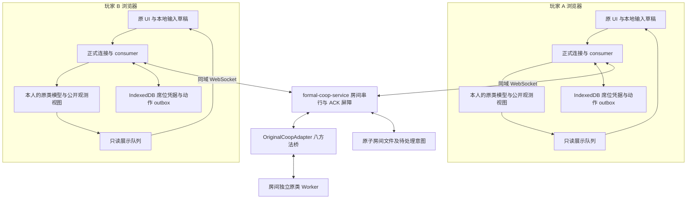
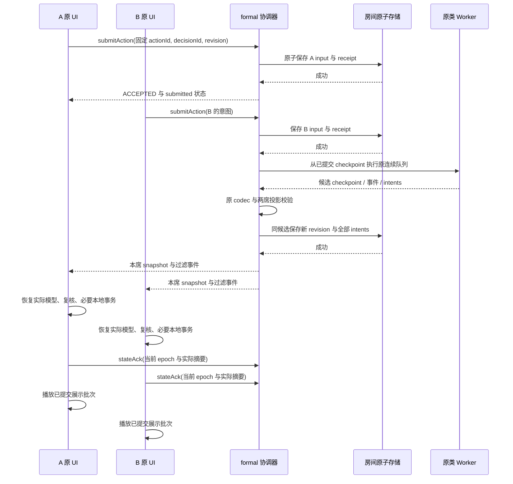

# 最快实现双端可玩的交付架构

2026-10-18 实施状态更新：VS-01 内部真实接缝已经过维护者修订验收，完整 920/920、类型／构建通过，见 [审查](mvp-vs-01-review-2026-10-18.md)。本文设计基点及未实现描述为历史；正式个人入局／原 UI／落盘续局／跨设备仍待 VS-02 实际开发，未因此提升上线状态。

日期：2026-10-18。代码核对基点：`92f43a32c4cf20009119fc73a2522ff785789241`。本文是实施设计，**不是已实现／已上线声明**。UI-01R／QA-03 的 912/912 只证明其对应回归版本。本文细化 [纵向切片顺序](mvp-vertical-slice-2026-10-18.md)，不重写原合作规则或删除完整目标。

## 1. 交付结论与范围

采用现有 **Node 单实例协调器＋每活跃房间一个原类 Worker＋安全停点检查点＋原游戏客户端**。先补桥接、私有投影、实际模型应用和原 UI 的薄适配；不换引擎、不引入微服务／Redis／新数据库、不先做增量快照／预测战斗。

交付分三步：

| 阶段 | 对玩家的意义 | 必须交付 | 不能据此宣称 |
| --- | --- | --- | --- |
| 接缝证明 | 内部开发验证 | 两个真实 WS 客户端消费真实原模型投影，首战→整备→第二战再次 FIGHT | 原 UI、正式个人选队、服务器重启、跨设备已完成 |
| 受邀可玩预览 | 两个人在原画面真正操作 | 建／入房与原选队、共同战斗、个人整备、普通下一战；基本成长／替补停点、保存续局及清楚的未支持提示 | 完整通关、全机制、全收藏事务、公开服务容量已验收 |
| 双机发布验收 | 同一地址访问即可一起玩 | 两台实际设备、同域 HTTP/WS、普通连续战斗、刷新／短断线／服务器重启恢复；性能与错误反馈验收 | 所有 early 组合均已适配 |

首个内部整备允许先走真实 skip／ready／unready；可玩预览应迁入已有普通奖励领取和常用消耗品切片。购物／重抽／转移／复杂成长等，逐项真实接通才开放，不能假扣款或领取。不能把“只有跳过的接缝验证”包装成完整奖励体验。

捕获／永久授予／孵化事务、特殊遭遇、训练家／Boss、未验证复杂机制可保留后续，入口明确暂不可用；自然走到未支持节点则安全暂停并保存，不跳过节点。普通升级、强制替补等频繁节点必须接入原决策，否则只是很快卡住的演示，不能完成可玩预览验收。

不按物种／世代建立白名单来规避机制，完整目录保留；PLAY-02 每席选择三只与测试夹具同为三只的事实不能混为“目录只有几只”。原版其他合法容量和本局备用等按已确认规则处理，当前 native 固定入口形状须在真实选队桥中核对。未接机制是适配缺口，不转为永久玩法限制。

## 2. 总体结构与状态所有权



| 状态 | 唯一负责人 | 生命周期／约束 |
| --- | --- | --- |
| HP／PP／顺序／经验／胜负／规则 RNG | Worker 内 early 原规则 | 临时候选执行；浏览器和主线程不重算 |
| 已提交本局、输入、回执、授予／意图账本 | 房间持久层 | 保存成功后才替换内存并发布 |
| 当前连接、在线、ACK、故障、计算任务 | formal 协调器 | 连接／进程态；重连或重启使确认失效 |
| 浏览器实际模型 | ClientModelAdapter | 只接受已验证服务器投影，供摘要和原 UI 读取 |
| 光标／选招草稿／已发送待回执动作 | 客户端输入控制器 | 草稿可即时改；已接受动作不可自行撤回 |
| HP bar、sprite、文本、动画进度 | PresentationController | 只读已提交事件；不修改规则模型 |
| 原个人收藏 | 本人浏览器 GameData＋M6 事务 | 不被合作本局 checkpoint 覆盖 |

原类和 checkpoint 是同一规则状态的执行／持久表示，由现有 codec 转换；客户端公开观测和动画状态是派生视图，不引入第三套规则公式。

## 3. 最先需要实现的代码接缝

以下新增名称是建议落点，创建前检查仓库是否已有同职责实现：

| 层 | 复用／新增落点 | 主要工作 |
| --- | --- | --- |
| 房间协调 | 复用 `server/formal-coop-service.mjs` | 保留串行、去重、持久提交和双端实际 ACK；增加按席位过滤事件及必要健康／资源释放钩子 |
| 八方法桥 | 新增 `server/original-coop-adapter.mjs` | 将正式 context／decision 映射到 Worker，封装初始化和候选意图，不写规则 |
| Worker 生命周期 | 复用 `server/original-rule-host.mjs`、worker | 按 run 隔离模块图，创建／复用／超时终止；无跨房间可变模型 |
| 原规则入口 | 扩展 `src/server/original-runtime.ts`、`native-entry.ts` | 薄校验／投影 RPC，正式个人初始化，迁入已有成长／替补／奖励绑定 |
| 投影契约 | 新增 `src/battle-core/original-coop-projection.mjs`（类型配 `.d.mts`） | shared／personal schema 与 capture；不依赖 DOM，不包含秘密或显示状态 |
| 原模型应用 | 新增 `src/coop/original-client-model.ts` | 恢复本人原类，应用公开观测，实际重新提取投影，保证一次替换 |
| 原 UI 薄适配 | 新增 `src/coop/original-ui-bridge.ts` | 接原 handler 的只读显示、输入意图和展示回调，禁止本地权威结算 |
| 动画调度 | 新增 `src/coop/presentation-controller.ts` | 已提交事件去重、排序、快进和快照追平 |
| 个人存储 | 复用 `src/coop/local-profile.ts`／原本地事务 | 席位凭据、待回执动作、后续授予原子事务；不回写实验收藏 |

优先抽取／迁移现有适配与测试助手中可复用的代码，再按生产依赖校验；不得直接 import tests/helpers 到服务或浏览器。复用来源、原逻辑与接口差异需在实现记录注明。

### 3.1 八方法的具体职责

| 方法 | 实施约定 |
| --- | --- |
| createInitialContext({runId}) | 创建持久化的 lobby／starter-ready context 和房间种子，不在第二席加入前偷偷生成双方固定队伍；内部夹具 provider 仅用于 VS-01 |
| describeDecision(context) | 返回稳定 id、requiredSeats、all／incremental／auto；由原决策和必要 lobby 状态导出 |
| validateAction(context,seat,action) | 连接派生席位；原 codec／合法意图校验；无扣款、抽奖、RNG 前进或模型修改 |
| advanceToDecision(context,inputs) | 按当前决策调用原 native 操作，连续执行到下一个真实交互／安全停点，返回独立候选、事件、意图／授予 |
| captureCheckpoint(context) | 捕获 adapter envelope＋原 v6/v7 checkpoint＋待处理意图；不把 Worker 引用或函数写盘 |
| validateCheckpoint(checkpoint) | envelope、版本、归属、所有原引用校验；native 模型由原 codec 验证，不能只查 JSON 字段 |
| restoreCheckpoint(checkpoint) | 原 codec 恢复／校验并重建可执行候选；Worker 缓存可丢弃，不能成为唯一真相 |
| projectSnapshot(context,seat) | 返回严格 shared／personal；决策仅暴露该席可用动作，避免全服务端 checkpoint 泄漏 |

现有 `native-validate` 主要处理 FIGHT，不能假定已校验整备／换人／选队。缺少的纯校验、原 codec 检查与投影能力增加薄 RPC；不能用“执行一次动作再扔掉结果”代替所有纯校验。

普通派发：FIGHT 用 submit→run-to-boundary；整备用 preparation／prepare-action；双方 ready 后用 next→run-to-boundary；换人用 switch→run-to-boundary。已暂停的原成长／替补回调从检查点恢复，不重新 start。native-step 仅诊断，生产不中途另造逐阶段规则路径。

### 3.2 建房与真实选队

状态顺序为 `lobby → starter-ready → battle-input → resolving → preparation → pre-battle-switch → battle-input`；暂停／恢复是外层状态，不篡改原胜负。

createRoom 当前只接收昵称且立即调用 createInitialContext，因此需要 lobby envelope；双方通过已有 submitAction 的版本化 action 载荷提交个人选择并 ready，沿用 incremental 决策，无需为首发再造大厅服务。服务器固定按席位顺序初始化双方，网络到达顺序不成为生成顺序。

原选队界面读取本人原收藏；提交物种、形态、性别／特性、性格、允许招式等原版选择数据及必要个人引导信息。服务器使用原工厂和原规则初始化，不接受客户端提供本局 HP／最终属性／金币作为权威值；只上传入局必需字段，不上传整份收藏。

当前 Worker 只接受一份 trainer identity，不能冒充已完成双方身份绑定。接线须按席位保留个人初始化信息和原构造语义，不能让 B 使用 A 的身份／闪光判定输入。训练家私有信息不进入队友投影。

本项目当前无账户认证，服务器只能验证本地导入数据的结构和规则合法性，不能证明客户端真的拥有某收藏。首发为受邀合作预览，不宣称竞技防作弊；不能为此新建账户系统阻塞接缝。

## 4. 检查点、投影与事件

### 4.1 同候选持久化 envelope

原决策 v6/v7 保持独立版本；adapter envelope 新设自身 formatVersion，不把旧 v6 自动变成空蛋 v7：

```text
RoomRecord
  versions, roomId, runId, revision, decisionId
  checkpoint
    formatVersion, stage, runId, initialSelections
    nativeCheckpoint          // lobby 时为空，战斗后为原 v6/v7
    intentOutbox[]            // 稳定 id / owner / type / payload / status
  inputs, receipts
  committedEvents[]           // 按 revision 的展示批次，可分席
  grants, grantAcks
  seats[]                     // 凭据仅服务器保存，不投影
```

此结构是目标 schema，旧房间无验证不能自动迁入。rulesVersion／contentHash 与 adapter formatVersion 联合校验；不兼容保留旧文件并拒绝恢复，不覆盖原档。

### 4.2 shared／personal 最小模型

| shared：两端相同 | personal：仅本人 | 不下发 |
| --- | --- | --- |
| 共同波次、公开战斗／场地状态、稳定 field 索引、公开在场精灵信息、公开状态与 HP、共同阶段必要规则事实 | 本人完整队伍原状态及别名关系、本局余额／背包／持有物、本人奖励／成长／替补选项、本人的蛋镜像及必要进度 | 席位恢复凭据、双方完整收藏、队友后备详细数据／私有选项、RNG 内部状态、内部任务和原完整 checkpoint |

HP 精度／哪些在场属性公开，按原 UI 与已确认合作可见信息逐字段核对，不默认暴露全部隐藏数据。所有权用稳定 pokemonId／owner，目标用原全局场地索引；不依赖单人 party 压缩。

不能把删去隐私字段的完整 checkpoint 交给完整决策 codec，再用假 IV／空队伍补齐。服务端保留完整规则模型；客户端恢复本人的真实 PlayerPokemon／相关原模型，对队友或敌方仅有公开数据时使用**只读观测视图**承接 sprite／HP 等显示。观测视图不参加伤害、目标合法性或 RNG 计算，不是替代规则引擎。

原 handler 如果需要从对方隐藏模型重新算目标／可用招式，改读服务器提供的本人合法 options，而不是给客户端补隐藏数据或重算公式。captureAppliedState 从已应用本人原类与公开观测实际读取并重投影，不能返回收到快照的缓存。本人同时出现在 shared 与 personal 时复用稳定对象绑定，避免 UI 读到两个不同 HP。

hash 使用现有 canonical＋SHA-256。run/revision/decisionId/epoch 保留协议元数据；网络 ACK／online、光标、语言、动画进度、文本不进入规则投影。原目录引用用稳定 ID，客户端按本地语言渲染。

### 4.3 展示事件也要按席位过滤

**当前 formal 服务把同一 `room.events` 发给两端，只有 shared／personal 投影过滤是不够的。** 新 adapter 输出带明确 scope 的 committed event：shared 或指定 seat；snapshot 构建时统一验证并过滤。现有八方法保留，事件过滤作为协调器公共职责，不另加一套传输服务。

生产事件必须有 `runId/revision/eventIndex/scope` 派生的稳定 eventId／frameId、原 actor／target ID，以及显示所需已提交结果；私有 reward／成长文本或参数不能进入 shared scope。按明确类型白名单映射，不能把原 phase 对象／原日志直接广播。既有协议夹具的公开 events 通过兼容测试单独处理，不能用其无 scope 的便利规则放行生产私有事件。

优先复用 snapshot.events 数组携带本次已提交展示批次，不另加逐动画帧 WS 消息。若顶层 schema 必须变化，显式提升 protocolVersion 并同步两端；不让严格 schema 静默接受额外字段。重连直接取当前快照，旧事件不承担恢复规则模型的职责。

## 5. 一次行动的完整链路



客户端草稿即时反馈；首次发送前，把完整 action envelope 与 actionId 写入本人本地 outbox，保存失败不发送新动作。outbox／席位凭据按服务器 origin＋run／seat＋本人档案绑定，不能把旧档案动作带入新局。网络重发使用原完整 action envelope 和同一 actionId。已持久接受后不因“动画还没演到”重复提交。服务器收包顺序只是收集顺序，原速度／优先级决定战斗顺序。

每个已接决策使用 all／incremental／auto：战斗收齐必要席位；整备一次处理一席合法意图；自动阶段在安全边界推进。必须保留预算上限，不能一口气执行到整局结束或在无决策变化时循环自推。

## 6. 双端体验：模型同步与动画分离

### 6.1 不让慢设备成为规则时钟

`stateAck` 的含义是“模型已正确应用、必要事务已成功”，**不是动画播放完毕**。沿用现有双 ACK 屏障，不增加每次受击／每条消息的动画 ACK。两端看到相同已提交结果和逻辑顺序，不要求像素级同时播放。

模型一次应用至新安全停点；PresentationController 从上次显示状态播放伤害／消息／召回等已提交结果，HP bar 可 tween，但不写 Pokemon.hp、不再次调用规则 damage/end，也不影响 captureAppliedState。原规则需要的 Summon 回调副作用仍在 Worker 执行，客户端只重现显示。

本地提交门：模型已核验、epoch 当前、本人是 requiredSeat、无已接受输入、当前输入界面已显示且展示队列已到可操作点。动画期间可预览信息／做本地草稿，不抢先向错误 decision 提交。双方动作收齐前，快的一方明确看到“等待队友选择”，不表现为按钮无响应。

队列落后时快进／合并纯显示事件；恢复或积压过多直接定位当前快照并给“已恢复到当前回合”的短反馈。不能丢规则动作或为了动画顺滑回放并重算旧回合。

### 6.2 个人整备不能互相打断

- 两端各自保留原奖励／队伍界面。队友的操作只更新其公开状态，不强制关闭本人菜单或重置 cursor。
- 本地菜单草稿用本人 optionId／pokemonId／可选集合指纹绑定，不只按全局 revision／decisionId 判断是否全部清空。新投影到达后复核仍可用的草稿，已经发送的动作不得换 envelope 后复用旧 actionId。
- “已准备／取消准备”“奖励尚未处理”“队友整备中”始终可见；准备条件由服务器验证。双方 ready 后才进入下一战。
- 不广播队友正在点哪个招式或奖励；状态提示与个人隐私选项分开。

### 6.3 可观察的 UI 状态

| 状态 | 玩家看到什么 | 可操作内容 |
| --- | --- | --- |
| 选择中 | 原菜单与队友状态 | 本人合法选择 |
| 发送中 | 按钮立即显示提交中 | 防重复提交，可查看信息 |
| 已接受／等队友 | 明确谁尚未选择 | 浏览信息，不能改已接受动作 |
| 结算中 | 简短进度反馈 | 不本地推进；超时可重连查权威状态 |
| 展示中 | 原动画／文本，可按原支持方式加速 | 到当前输入点后开放菜单 |
| 断线／恢复中 | 哪一端断线、恢复状态 | 重连原席位，不自动代选 |
| 保存失败／版本不符 | 原因、保留数据、可恢复入口 | 暂停，不能继续消耗 |
| 未支持节点 | 当前进度已保留、此功能暂不可用 | 保存／退出／后续恢复，不跳过节点 |

上述是产品反馈，不在 UI 中展示 codec／RPC 内部术语。输入手感来自本地反馈，战斗结果完全以服务器为准，不做预测扣血或预测扣款。

## 7. 持久化、刷新与重启

保留 FormalRoomStore 的单房间原子文件路径，补齐 envelope 验证与必要平台持久化检查。先写临时文件→文件同步→原子替换→更新内存→发布。文件替换、断电保证因平台而异，发布前用目标部署环境验证；不承诺仅凭 rename 就具有任意平台绝对断电安全。

| 中断位置 | 恢复依据 |
| --- | --- |
| 客户端发送后未收到 receipt | 本地 outbox 保留相同完整 action；重发查询／复用原 receipt，不生成新 ID 再扣一次 |
| 只收到 A input 后进程重启 | 同文件 input／receipt 保留，双方重连重新核验 ACK，等待 B |
| Worker 计算中崩溃 | 丢弃候选，从旧 checkpoint＋已收 inputs 重算；无未提交结果广播 |
| 新 checkpoint 落盘成功、广播前崩溃 | 以新 revision 为准，客户端恢复当前快照，不再次执行旧 inputs |
| 房间写盘失败 | 保持上一提交、撤销 ACK、暂停；恢复后核验并重新发布，不把内存候选当已提交 |
| 页面刷新／后台恢复 | resumeSeat→新 epoch→完整模型核验；丢弃旧展示队列和旧异步回调，仅重发仍待确认的原动作 |
| 本地必要事务失败 | 不 ACK，不覆盖成空档；重取快照并由幂等事务恢复 |

客户端 IndexedDB 只存席位凭据、待回执动作、必要个人数据和后续授予账本；服务器存权威本局。换 IP／域名是不同浏览器存储来源，必须提供明确迁移／恢复说明，不能声称 localhost 的收藏会自动出现在 IP 地址。

### 7.1 M6 的最小预留

deferEncounterPersistence／seen 等结果进入同候选 intentOutbox；用 run＋稳定阶段／结果身份生成 id，保存 owner／type／payload／pending，不按每次重试生成新 UUID。房间存储失败时不对外消费意图。

后续 M6：服务端持久 grant→本人原 GameData 事务同时更新收藏与 grant ledger→grantAck→stateAck。远端和 IndexedDB 之间没有分布式原子提交，依靠可重发消息、稳定 ID 与本地原子事务实现不重复授予；不得宣称网络“严格 exactly-once”。

永久结果在 M6 完成前保持未消费停点，不消耗蛋、不发未确认的券、不把 pending intent 伪装成收藏已保存。双方蛋推进／归属与 v6/v7 约束不变。

## 8. 确定性与 Worker 维护成本

- 连续原规则是普通生产主路径；从安全停点恢复后继续同一路径。逐阶段运行用于差分／诊断，不以删除 codec 或恢复验证换工期。
- 房间种子、场景／战斗 RNG、池状态、已提交顺序写 checkpoint；客户端时间、网络重试次数、动画速度不得进入规则裁决。
- 初始双方生成和菜单生成按已验证席位顺序执行。先保持已验收的房间持久顺序语义，不临时引入独立个人随机流，也不声称所有个人重抽与到达顺序无关。
- 原目录 bootstrap 和规则执行的随机依赖分别盘点。可达的未绑定 Math.random／Phaser RND、真实时间输入和未知渲染必须暴露；不能用全局兜底随机凑通过。
- 每个接入机制记录原 callback 的规则写入与纯显示：保留 field 加入、道具更新、phase 结束等必要语义，动画时长仅虚拟调度，不让真实墙钟决定结果。
- 一个活跃房间一 Worker；首次两个玩家准备前可只驻留 lobby 数据。关闭／超时／空闲回收必须从最后持久检查点可重建，不把 Worker 内存当唯一真相。
- 先测实际 RPC／恢复成本；之后才缓存同一不可变 checkpoint 的校验与投影结果。缓存键含版本与内容摘要，不能跳过变化状态的验证。

全量确定性不能靠架构保证；受邀版本只对已实际验证路径作兼容声明。自然遇到未知分支要有可恢复停点，不把错结果发布成成功。

## 9. 部署、性能与发布开关

邀请链接只带公开房间码和服务器地址，不带私有席位恢复凭据。席位凭据通过 welcome 后的本地事务保存；保存失败不能假装具备刷新恢复能力。

首发单 Node 进程承载 HTTP／WS，静态原游戏与 `/coop/v1/ws` 同源；局域网双方访问服务器 IP，同域远程使用 HTTPS／WSS。原 `/` 与 `/coop.html` 实验入口保持独立，正式合作不回落实验引擎。若现有服务不足以托管静态资源，使用同源反向代理；首次发布不依赖新的云产品。

默认 ADAPTER_UNAVAILABLE 保持到真实 adapter 被显式配置且通过验收；测试进程可注入，生产开关不引用测试模块。不做浏览器直连 P2P、自动穿透、跨服大厅或大规模 Worker 池。

保留版本校验、Origin 校验、私有席位凭据和原输入队列限制；上线前补最基本建房／消息速率与实际房间容量上限。现有 500 房间只是代码上限，不是容量证据。回执在本局内不得被简单淘汰以节省空间；达到可测预算应拒绝新输入或停止接纳新局，不让旧 actionId 重执行。

现有客户端消息上限 64KiB；入局只发送必要选择数据，不为整份个人收藏直接放大限制。初期发完整规则投影便于恢复与核验，量出真实大小后再决定压缩；不先引入复杂增量同步。缓慢连接积压时停止追加无界展示帧，重取最新快照，而不是无限增长内存。

以下是**待实测的验收目标，不是当前性能承诺**；设备／网络条件、样本数和 p95 必须随报告记录：

| 指标 | 初始验收目标／方式 |
| --- | --- |
| 本地按钮响应 | 100ms 内显示选中／发送中反馈；不等待网络才能亮按钮 |
| 接受回执 | 稳定 LAN p95≤300ms；远程在 RTT≤150ms 时 p95≤800ms，包含持久化；达不到先分解 RTT／fsync／队列 |
| 普通已收齐回合计算 | 已预热 Worker p95≤500ms；冷启动单独统计，不能混在普通回合里 |
| 短断线恢复 | 网络恢复且页面在前台后，目标 5 秒内恢复可操作／明确错误；不能无限旋转 |
| 展示积压 | 不积压超过两个决策边界；必要时快进／快照追平，不损失规则状态 |
| 长局与隐私 | 无重复扣款／扣 PP／经验；断线无跨席接管；WS 抓包不含对方私有内容 |
| 资源 | 每房实际 RSS／heap、Worker RTT、checkpoint 和双投影字节数、WS 待发送字节实测；据此决定受邀并发，不按 bundle 大小推算 |

若现有 headless 分支达不到正确性，先定位最小可达差异，不靠换时间阈值或显示假结果满足指标。性能不足优先减少重复 restore／projection／广播，规则一致性不降级。

## 10. 实施批次与放行门槛

| 顺序 | 工作 | 可见成果／验收 |
| --- | --- | --- |
| A：纵向接缝 | 八方法桥、原模型投影／恢复、原始 intent 保留、双 WS consumer | 真正首战→第二战再 FIGHT，篡改一端实际模型阻止 ACK；记录第一份真实快照大小／RPC 耗时 |
| B：可恢复原 UI | lobby／本人原选队、房间同候选落盘、原 handler 与展示分离、基本奖励／成长／替补绑定 | 两独立浏览器原画面连续普通战斗，独立整备不互相弹窗；刷新／单方输入／写盘失败恢复 |
| C：双机发布 | 同源地址、实际两设备、连接／资源预算、错误可见性与版本回滚 | 两真实玩家至少完成三场普通战斗，并用可复现场景覆盖升级与替补交互；中途短断线与服务器重启后续局；未支持节点明确暂停 |

跨端验收必须使用不同浏览器档案并最终使用两台真实设备，固定 WS 脚本不替代这一项。还需至少两种操作速度／动画速度，证明慢端不让快端失去操作反馈、快端不越过未确认模型。

测试跟随实际切片：原连续／恢复差分、真实双 WS／实际模型核验、输入去重、旧 epoch、服务器／客户端存储失败、两房间隔离与原单人回归。只补与新接缝有关的必要断言，不再分配大批离线外围任务作为上线前置。

实现负责人持有 adapter／投影／事务／规则绑定；较弱 agent 可接具体 handler 的展示适配、错误文案与既定双端用例，但必须在真实桥已存在后工作，不让其另造权威规则或决定未确认玩法。

不承诺无依据的日历工期。先交 A 的贯通证据，依据实际接口缺口和测量再排 B／C。最快上线依赖减少并行架构和返工，不依赖跳过基础存储／隐私／真机验证。

## 11. 明确保留的决策与风险

已确认的经验、双方蛋推进及归属、始终双打与奖励排除三种诱饵照 SPEC 执行，不重复询问。券归属／时机、敌我同回合全部倒下的最终顺序仍未决定，不在本设计中定案。

必须在首个接缝中暴露：双方真实身份初始化、全量原模型与私有投影不等形、原 UI 隐式本地规则调用、私有展示事件泄漏、auto 决策与动画积压、pending intent 同候选保存。它们是实际开发工作，不能用“已有 912 项通过”替代。

本设计追求可测的双端反馈、正确同步和恢复，不声称尚未适配机制可以无停点游玩。若要求任意 early 内容都能连续完整通关，则需完成相应完整机制与 M6，不能同时当作最快首发承诺。
